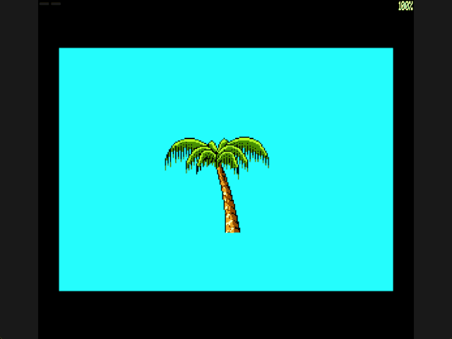
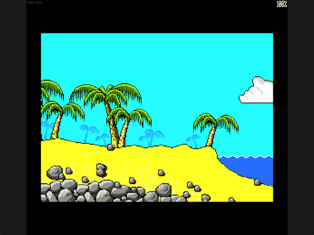

Welcome to the latest in my series of posts on Graphics with the SAM Coupé.

You can find the earlier posts in the [series repository](https://github.com/pjgpetecodes/samcoupegraphics).

# Drawing Treasure Island Dizzy's First Background

The [previous post](https://github.com/pjgpetecodes/samcoupegraphics/blob/main/assembly/blog9/blog-post.md) positioned Dizzy at pixel resolution. This time we will deliberately put the moving player aside and concentrate on one new concept: a background.

We will first display one palm tree, then the starting beach taken from the supplied Treasure Island Dizzy game. Neither example has a moving player, collision, gravity, collectables or room transitions. Moving over scenery without erasing it is the next lesson.

Thank you to Adrian Brown for supplying the graphics and helping with this series. The supplied game's title artwork credits Codemasters, 1989. The graphics are reproduced with the rights-holder permission provided for this project; the tutorial program is independently written, not the original game engine.

## What Was Recovered?

The starting beach is native room 77 in the supplied SAM game. Its scenery was reconstructed from the game's graphics pointers and draw records, then compared with the user-confirmed starting-screen capture. This is not a hand-drawn approximation or an intro screenshot relabelled as gameplay.

For this lesson we use only a packed static bitmap. The palm trees, sand, rocks, cloud and first water frame are included. Dizzy, the chest, coin, moving actors and original decorative HUD are not baked into it. These have their own state and will be introduced separately. The top 48 rows are reserved for a later HUD and are currently cyan.

The four intended rooms have now been identified: starting beach 77, cliff beach 76, mostly empty sky 108, then grassy/tree room 107. The route goes left, **up**, then left; it is not four consecutive rooms to the left. The bridge beyond them is room 106, screen 5, and remains outside our slice. We do not add those transitions in this post.

## MODE 4 Is Still a Packed Screen

A MODE 4 screen is 256 pixels wide and 192 rows high. Two four-bit palette indices occupy each byte, giving a 128-byte row stride:

```text
192 rows * 128 bytes = 24,576 bytes = 0x6000
address = row * 128 + pixel_x / 2
```

In the previous examples colour zero was deliberately black. Here it is deliberately the source game's cyan sky. The actual black entry is palette index seven, which we use for the border. Recolouring zero with keys 1-5 would recolour scenery, so that earlier palette demonstration is no longer active in these static examples.

We retain the existing palette loader and reapply the palette after every `HALT`, because the ROM interrupt restores system palette values. The CLUT bytes themselves are unchanged.

## Step 1: One Palm

[12-1.asm](https://github.com/pjgpetecodes/samcoupegraphics/blob/main/assembly/blog10/12-1.asm) displays source graphic 6. Its first two bytes contain its width in screen bytes and height in rows; the following data is packed MODE 4 pixels.

```z80
Copy_Width:     EQU     41              ; Image 6 stores 82 MODE 4 pixels per row
Copy_Rows:      EQU     77              ; Copy all 77 rows of the source palm
Source_Start:   EQU     2               ; Skip the image's width and height header
Destination:    EQU     70*128+40       ; Place the palm at byte X=40, row Y=70
```

We copy 41 bytes across each destination row, but advance **128 bytes** to find the start of the next row. Advancing by the graphic width instead would squash the image into consecutive screen bytes.

This is a rectangular copy onto an empty cyan screen. Colour-zero pixels in the image therefore produce the same cyan as the surrounding screen. We are not yet teaching transparent composition of several independently placed objects at runtime.



Download [the 12-1 disk](https://github.com/pjgpetecodes/samcoupegraphics/raw/refs/heads/main/disks/12-1.dsk).

{{emulator:12-1}}

## Step 2: The Starting Beach

[12-2.asm](https://github.com/pjgpetecodes/samcoupegraphics/blob/main/assembly/blog10/12-2.asm) uses exactly the same copier, this time with a complete screen:

```z80
Copy_Width:     EQU     128             ; Each full MODE 4 row occupies 128 bytes
Copy_Rows:      EQU     192             ; Copy the complete 192-row screen
Source_Start:   EQU     0               ; The packed screen has no dimensions header
Destination:    EQU     0               ; Begin at the top-left display byte
```

The room composition has already been resolved by the extraction tool. Our SAM program just copies pixels. A later post will replace this precomposed screen with reusable graphics and room data; doing that here would introduce another concept too soon.



Download [the 12-2 disk](https://github.com/pjgpetecodes/samcoupegraphics/raw/refs/heads/main/disks/12-2.dsk).

{{emulator:12-2}}

These are static demonstrations, so the GIFs can contain a single retained image even though they were captured over several seconds. There is intentionally no moving water or player.

## Copying Between Banked Memory Areas

The source bitmap occupies physical pages 4-5. We build the visible result in hidden display pages 14-15, while pages 10-11 remain displayed. Code, palette, state, a 128-byte row buffer and the stack stay in resident pages 1-2.

The source and destination cannot both occupy the lower CPU window. Instead:

1. Map source pages 4-5 and copy one row into the resident buffer.
2. Map hidden screen pages 14-15 and copy the buffer to the destination.
3. Advance the source by its packed width and the screen by 128 bytes.

```z80
Copy_Row:       LD      A,4             ; Select the source bank pair
                CALL    Map_Lower       ; Make the source row visible
                LD      HL,(Source_Pointer) ; Recover its address
                LD      DE,Row_Buffer   ; Use storage that survives paging
                LD      BC,Copy_Width   ; Copy one packed source row
                LDIR                    ; Stage pixels before changing mappings
```

Interrupts remain disabled throughout this one-off initialization. We restore the original lower mapping before enabling interrupts or executing `HALT`. Once every row is ready, we switch VMPR to display page 14. We do not repeatedly copy 24 KB every frame.

Both entry points include the same [static-background.asm](https://github.com/pjgpetecodes/samcoupegraphics/blob/main/assembly/blog10/static-background.asm) runtime. Each instruction and directive is commented. `MDAT` is pyz80's binary-data inclusion directive; it puts graphics bytes into the chosen `DUMP` page, not into the executing program's address range.

The resident end is `0x8148`, safely below the `0xFF00` stack. The complete screen ends at lower-window address `0x6000`, inside its 32 KB source pair. Assertions check screen dimensions, row bounds and the resident limit. The layout fits a 256 KB SAM.

## Reproducible Graphics, Not Original Game Code

The [asset provenance](https://github.com/pjgpetecodes/samcoupegraphics/blob/main/assembly/blog10/assets/provenance.json) records the source-disk hash, file offsets, palette, graphics dimensions and room draw records. It also distinguishes static collision data from the image. Collision files are preparation for later posts and are not consumed by either example here.

The existing extractor now supports the four selected rooms:

```powershell
python .\.vscode\extract_tidizzy.py --rooms --disk "C:\path\to\TIDizzy.dsk" --output "C:\path\to\new-room-output"
```

The destination must not already exist. The tool checks the known disk hash and data boundaries; it exports only selected graphics, layout data, static collision and previews. It does not emit original game code, disassembly or another copy of the disk. Its RGB previews use the SAM CLUT's correct channel bit weighting; assembly continues to use the original hardware palette bytes.

## Building and Running

```powershell
python .\.vscode\sam_build.py .\assembly\blog10\12-1.asm --build-only
python .\.vscode\sam_build.py .\assembly\blog10\12-2.asm --build-only
python .\.vscode\capture_gifs.py 12-1 12-2
```

Both examples were run in SimCoupe with 256 KB configured, and the captured palm and beach were inspected. Reset to stop; there are no controls in this static lesson. The WordPress emulator embeds still require uploading these new disks to the site's separate disk-hosting location before publication.

## Where to Go Next

Our old erase routine fills Dizzy's previous rectangle with colour zero. Over this beach it would remove palm trunks, sand and rocks. The next post will restore those pixels from the authoritative background before drawing the moving sprite.
