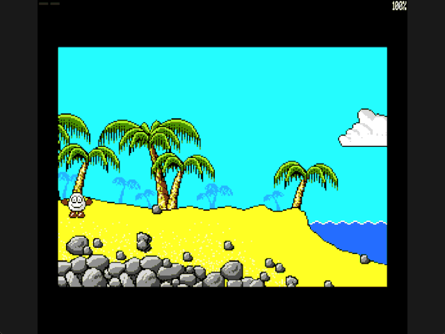

Welcome to the latest in my series of posts on Graphics with the SAM Coupé.

The earlier posts and source examples are available in the [series repository](https://github.com/pjgpetecodes/samcoupegraphics).

# Restoring Scenery Behind Dizzy

The [previous post](https://github.com/pjgpetecodes/samcoupegraphics/blob/main/assembly/blog10/blog-post.md) drew a palm tree and then the starting beach from Treasure Island Dizzy. We kept both examples static. Now we will put the moving, pixel-positioned Dizzy back into the picture without rubbing out the scenery.

Thank you to Adrian Brown for supplying the graphics and helping with the series. The background assets retain their [extraction provenance](https://github.com/pjgpetecodes/samcoupegraphics/blob/main/assembly/blog10/assets/provenance.json) and the rights-holder permission described in the previous post. The drawing program is our tutorial code, not the original game's engine.

This lesson adds **background restoration only**. There are still no walls, ground support, gravity, collectables, hazards or room changes. Dizzy moves along a fixed row, including across water and through decorative objects. Those are intentional limits of this drawing demonstration, not claims about the source game's collision.

It also changes how the source is organised. From this post onwards the program is **split into several files, one per feature**. We explain why, and how, near the end of the post, after the restoration code.

## Why Clearing to Zero Stops Working

Previously we erased the old sprite rectangle by filling it with palette index zero. That was sufficient on a plain background. Over a beach it would remove sand, tree trunks and rocks, replacing them with cyan rectangles.

We need a source of truth for the pixels underneath the player. A screen that already contains Dizzy is not that source: copying from it can copy the old sprite back into the scene.

Our solution is an immutable, screen-sized background bitmap in its own bank pair. Before drawing the next sprite, we copy the old rectangle from that bitmap to the hidden display screen.

```text
restore this hidden page's OLD rectangle from the background
draw the sprite at its NEW pixel position
restore ROM mapping
flip only after the frame is complete
```

We do not redraw all 24 KB of scenery on every movement update.

## Keep the Three Memory Roles Separate

| Physical pages | Contents |
|---|---|
| 1-2 | Resident program, animation tables, frame buffers, row buffer and stack |
| 4-5 | The unchanged banked Dizzy frames |
| 6-7 | Authoritative 24 KB starting-room background |
| 10-11 | First display screen |
| 14-15 | Second display screen |

This still fits a 256 KB SAM. Neither HMPR nor the resident code mapping changes. The new background source does not overlap the executing program, stack, sprites or display pages.

The program ends its resident allocation at `0x88AC`; the stack starts at `0xFF00`. The background occupies lower-window addresses `0x0000` through `0x5FFF` when pages 6-7 are mapped.

## Initialize Both Display Screens

Both screens must begin with the complete scenery. Otherwise the first flip would reveal an uninitialized screen and restoring one small sprite rectangle would not repair the rest of it.

At startup we call the same background copier twice, once with page 10 as the target and once with page 14. For these calls the rectangle starts at zero, is 128 bytes wide and has 192 rows. These full-screen copies happen only during initialization.

We retain the original cyan palette entry zero and black border at index seven. The earlier palette keys are no longer active: changing the sky entry as a demonstration would recolour scenery. The ROM interrupt still requires the palette to be reloaded after `HALT`.

## Restore the Old Physical Page Position

The per-page previous positions from Blog 9 are still essential. The hidden page may contain a sprite from two display updates ago; erasing the single globally previous position would leave trails.

We also preserve the old position's parity. An even X used 13 destination bytes, while an odd X used 14. We must restore the width of the **old** drawing, not select its width from the new X.

```z80
                LD      (Restore_Pointer),HL ; Restore this physical page's old rectangle
                LD      A,(Old_Width)   ; Use old parity, not the new position's parity
                LD      (Restore_Width),A ; Copy all 13 or 14 previous destination bytes
                LD      A,Sprite_Rows   ; Restore the complete cropped height
                LD      (Restore_Rows),A ; Retain the count outside the banked window
                JP      Restore_Background ; Replace old pixels before drawing the new frame
```

Restoring full packed bytes is safe here: the source supplies both original background nibbles, then the new masked sprite is drawn over them. There are no other independently moving objects to erase accidentally. Multiple moving actors will need an explicit composition order later.

## Stage a Row Across the Mapping Change

As in the static lesson, source scenery and destination screen both use the lower CPU window. We cannot simply use `LDIR` between two addresses there and assume they refer to different physical pages.

For each old rectangle row:

1. Map background pages 6-7 and copy 13 or 14 bytes into the resident `Background_Row`.
2. Map the selected hidden display pair and copy those bytes to the identical screen offset.
3. Advance the offset by the 128-byte screen stride and repeat.

`Target_Page` retains the physical hidden screen while the source is mapped. `Restore_Pointer`, width and row count are resident too. The buffer is 128 bytes because the initialization calls also use this copier for a full-width screen.

```z80
Restore_Background:
                LD      A,Background_Page ; Read authoritative scenery, not another display
                CALL    Map_Lower       ; Make the source rectangle row visible
                LD      HL,(Restore_Pointer) ; Locate its packed byte offset
                LD      DE,Background_Row ; Preserve the row above the banked window
                LD      A,(Restore_Width) ; Read the rectangle width
                LD      C,A             ; Set the low byte of the copy count
                LD      B,0             ; Width is at most 128 bytes
                LDIR                    ; Stage the source before paging it away
```

Interrupts are disabled while source or screen RAM occupies the lower address space. The full original LMPR value is restored before interrupts are enabled again. Scenery is restored and the new masked frame is drawn before VMPR changes.

## What Has Not Changed

The original and odd-shifted sprite forms remain cached in resident memory. X remains a pixel coordinate, with the one-/three-pixel step demonstration retained from Blog 9. Z/X select direction, Z wins if both are held, and Space retains the existing roll and directional-jump animations.

Those jump sequences are not physical jumps. The sprite's top row remains 115 throughout the example. Keeping Y fixed lets us inspect scenery restoration independently of ground collision or gravity.

The loop is interrupt-paced, not a guarantee of 50 completed renders each second. Banked restoration adds work; we do not claim a new measured movement rate or shorten the animation delay to conceal it. The next engine stages should continue to budget their rendering work rather than treating `HALT` as a performance guarantee.

## Splitting the Program into Files

Up to now each example has been one long `.asm` file. That made sense while the program was small: you could read it top to bottom and build it with one command. From here, though, every post adds another feature: rooms, collision, gravity, jumping, items, an inventory, animated water, hazards and a bee. Kept in one file, the program would grow to almost 2,000 lines.

- **Finding things gets hard.** Gravity would sit between room exits and the hazard test, and a feature's variables would be hundreds of lines away from its code.
- **Spotting what changed gets hard.** A post that adds a twenty-line rule would still ship another complete, huge file, and you would have to hunt for the twenty lines.
- **Changes get risky.** With everything in one place it is easy to edit a routine you did not mean to touch.

So we split the program now, while it is still small, and every later post builds on the split.

### How INCLUDE works

We have used pyz80's `INCLUDE` since the early posts to pull in the palette loader and the sprite frames. It is purely textual: the assembler reads the named file at that point as if its lines had been typed there. The files are not separately compiled modules. There is still one program, one set of labels and one run of addresses from `ORG 0x8000` onwards.

1. **Labels are global.** `walking.asm` can `JP Draw_Frame` in `dizzy_sprite.asm` without any imports or exports.
2. **Include order decides addresses.** Whatever is included first is assembled first. Moving a routine to another file changes where it lands in memory, but not what it does.
3. **Paths are relative to the including file.** `INCLUDE "constants.asm"` finds the file next to `13-1.asm`.

### The new layout

`13-1.asm` is now short enough to read in one sitting. It sets the origin, runs `Start` and the main loop, then includes each feature:

| File | Lines | What it does |
|---|---|---|
| `13-1.asm` | 52 | Program origin, start-up and the main loop |
| `constants.asm` | 17 | Ports, memory pages and tuning values; only `EQU`s, so it produces no bytes |
| `walking.asm` | 44 | Z/X input and the horizontal pixel steps |
| `screen_paging.asm` | 62 | Lower-memory paging, background restoration and page flips |
| `dizzy_sprite.asm` | 298 | Dizzy's animations, odd-pixel shifting and drawing |
| `variables.asm` | 26 | Variables shared between the files |
| `sam_palette.asm` | 44 | The unchanged palette loader |
| `paged_data.asm` | 17 | Sprite frames and scenery assembled into other memory pages |

Each file starts with a short header describing its job, and every line keeps its comment. The data files (`assets\tidizzy_cropped.asm` for the sprite frames and `assets\screen-1.bin` for the beach) sit in an `assets` folder.

### Every post's folder stands on its own

Each post's folder holds a **complete copy** of every file it needs, including the palette loader and the graphics. Nothing reaches back into an earlier post's folder. You can download one folder, build it, and change it without breaking any other example.

To write the next post we copy this folder, change only the files the new feature touches, and add new, logically named files for new features, such as `rooms.asm` next time and `collision.asm` after that. Each post lists which files are new and which have changed, so you can go straight to the interesting part.

### Rules for a safe split

Moving assembly code around is not as innocent as moving functions in a high-level language. We follow four rules from here on:

1. **Never cut through a fall-through.** A routine without a final `RET` or jump simply runs on into whatever follows it in memory. Every split point comes after an unconditional `RET`, `JP` or `JR`.
2. **Keep block data together.** Variables that are used as a group stay side by side in one file. For example, the previous positions for each display page are chosen by page.
3. **Let each feature own its data.** Data used by only one feature lives in that feature's file, next to the code that uses it.
4. **Keep the memory layout rules.** All the resident files are included before `Frame_Buffer` and `Resident_End`, so the `ASSERT` still covers everything. `paged_data.asm` comes last because it switches to `ORG 0` and `DUMP` to place data into other physical pages.

The split changes the shape of the source, not the program. The resident program still ends at `0x88AC`, and the assembled bytes are the same instructions and data as the single-file version, just in a different order.

## Source, Disk and Result

Start with the line-by-line commented [13-1.asm](https://github.com/pjgpetecodes/samcoupegraphics/blob/main/assembly/blog11/13-1.asm), then follow its `INCLUDE` lines into the [other files in the blog11 folder](https://github.com/pjgpetecodes/samcoupegraphics/tree/main/assembly/blog11).

Download [the 13-1 disk](https://github.com/pjgpetecodes/samcoupegraphics/raw/refs/heads/main/disks/13-1.dsk).



The recording crosses the scenery in both directions, reaches the screen edges, stops, rolls, and exercises simultaneous direction keys. The palm trunks, sand and rocks remain intact behind him. The program was run with 256 KB configured in SimCoupe; the captured frames were inspected for trails and parity-width errors.

{{emulator:13-1}}

The embed still needs this disk uploaded to the site's separate disk-hosting location before publication. Generating this draft or its WordPress export does not upload it.

## Building and Running

```powershell
python .\.vscode\sam_build.py .\assembly\blog11\13-1.asm --build-only
python .\.vscode\capture_gifs.py 13-1
```

The folder contains its own copies of the unchanged Blog 6 palette loader and sprite frames, and Blog 10's verified packed background. Reset to stop.

## Where to Go Next

We can now move over a faithful static scene without destroying it. Next we will build that scene from reusable graphic blocks and a compact room description instead of loading a whole precomposed screen. Collision will remain separate from visual composition.
