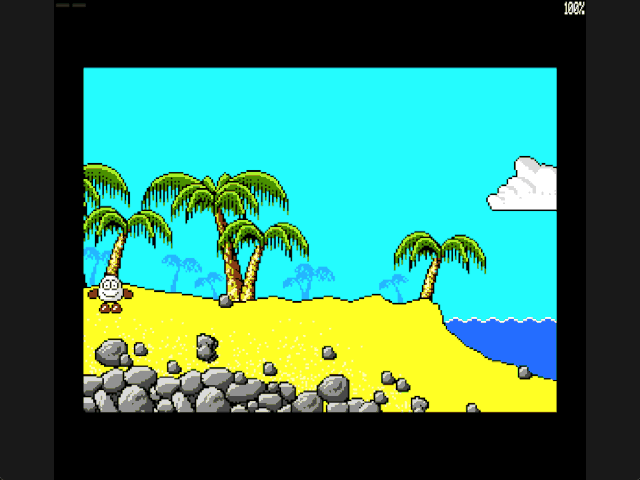

Welcome to the latest in my series of posts on Graphics with the SAM Coupé.

The earlier posts and source examples are available in the [series repository](https://github.com/pjgpetecodes/samcoupegraphics).

# Building a Room from Reusable Graphics

The [previous post](https://github.com/pjgpetecodes/samcoupegraphics/blob/main/assembly/blog11/blog-post.md) restored a moving sprite's old rectangle from an authoritative background. We will keep that drawing behaviour, but change how the background is created.

Instead of loading a precomposed screen, we will build the starting beach from reusable graphics and a compact room description. This is **data-driven composition**, not room transitions, collision or a tile-map engine.

Thank you to Adrian Brown for supplying the graphics and helping with this series. The assets retain the [source provenance and extraction metadata](https://github.com/pjgpetecodes/samcoupegraphics/blob/main/assembly/blog10/assets/provenance.json) introduced in Blog 10. Our renderer is independently written tutorial code.

## The Same Scene, a Different Representation

The starting beach uses repeated sand, rock, palm and vegetation graphics. Storing another complete 24 KB bitmap for every room would duplicate those pixels.

The source game's room records identify a graphic, a signed byte X and a signed row Y. Some graphics deliberately extend off screen; others overlap. We retain their draw order and transparent colour-zero nibbles.

The extraction tool resolves clipping offline and produces a simpler tutorial-owned record:

| Bytes | Meaning |
|---|---|
| 0-1 | Source address of the first visible packed pixel byte |
| 2-3 | Destination offset in the background bitmap |
| 4 | Visible width in packed bytes |
| 5 | Visible height in rows |
| 6 | Original source-row stride |

Each room starts with a one-byte block count. The starting room has 85 visible records after clipping; two original records are completely outside the playfield. This list is a drawing description, not executable original game code.

All four verified room descriptions are prepared in the generated include, but this program selects **only `Room_1`**. There is no input for changing rooms. We retain the planned two-room introduction and later four-room expansion as separate lessons.

## Clip Without Changing the Source Stride

Suppose a graphic starts two bytes beyond the left edge. We skip its first two source bytes, reduce its visible width and begin at screen byte zero.

The following source row still begins one **original graphic width** later, not one clipped width later. This is why the record stores both visible width and original source stride.

The converter also clips above row 48, preserving the original HUD reservation, and below row 191 or beyond byte 127. Fully off-screen blocks are omitted. Focused extraction tests cover negative coordinates, the HUD boundary, the bottom-right corner and unchanged source strides.

This offline clipping keeps the new SAM lesson focused on reading room data. It does not introduce a general runtime sprite-clipping system or change the player's existing screen bounds.

## Memory for Reusable Graphics

We retain the established pages and add one bank pair:

| Physical pages | Contents |
|---|---|
| 1-2 | Resident renderer, state, draw records, row/frame buffers and stack |
| 4-5 | Dizzy's unchanged source animation frames |
| 6-7 | Authoritative background, now composed at startup |
| 8-9 | Reusable source graphics |
| 10-11, 14-15 | The two display screens |

The 34 graphics needed by the selected four rooms occupy 29,991 bytes, ending at lower-window address `0x7527`. They fit in pages 8-9 without touching display page 10. The program and its resident tables end at `0x8F94`, below the `0xFF00` stack and the asserted `0xC000` resident limit.

We still need the authoritative 24 KB working background for restoration. Reusable assets reduce duplication between room descriptions; they do not eliminate that working buffer.

## Compose the Background Once

At startup `Build_Room` clears pages 6-7 to colour zero, selects `Room_1`, and reads each seven-byte draw record. `Compose_Block` stages one visible graphics row from pages 8-9 into the existing resident row buffer, maps pages 6-7, and overlays that row.

```z80
                LD      HL,(Block_Source) ; Read this graphic's source row
                LD      DE,Background_Row ; Stage bytes outside the banked window
                LD      A,(Block_Width) ; Read only the visible packed width
                LD      C,A             ; Prepare the copy count
                LD      B,0             ; Width does not exceed 128 bytes
                LDIR                    ; Retain the row before mapping the target
```

The source advances by `Block_Stride`; the destination advances by the MODE 4 screen stride of 128 bytes. The two increments are deliberately independent.

The generated [room-graphics.asm](https://github.com/pjgpetecodes/samcoupegraphics/blob/main/assembly/blog12/assets/room-graphics.asm) uses `MDAT` to include only graphics files. The [room-data.asm](https://github.com/pjgpetecodes/samcoupegraphics/blob/main/assembly/blog12/assets/room-data.asm) include holds the source pointers, clipped destination offsets and dimensions. Both are generated by the existing extractor, not hand-transcribed from game bytes, and copied into this post's `assets` folder.

## Transparency and Draw Order

These source graphics contain packed pixels, not the interleaved masks used by Dizzy. A zero nibble is transparent. We test each half of a source byte separately, retaining the existing background nibble when that source half is zero.

For example:

```text
background: A B
source:     0 C
result:     A C
```

A whole-byte zero check would not handle that partial transparency correctly.

The block list is processed in order, so later opaque pixels cover earlier ones. Water records are placed last and use their first animation image. The tutorial does not animate water yet.

Static collision masks remain separate extraction outputs. They are **not** consulted by this renderer and do not determine visual transparency. A decorative palm can be visible without being solid.

## Preserve the Established Movement Renderer

Once the authoritative scene is complete, we initialize both display screens from it. Moving Dizzy uses exactly the established old-rectangle restoration, masked drawing and hidden-page flip.

We do not rebuild the room every update. We do not change movement speed, animation delay, controls or sprite data. Z/X move horizontally, Space retains the existing animations, and Y remains fixed. Passing through scenery is still expected because collision has not been introduced.

Interrupts stay disabled during initialization and banked rendering. The complete original LMPR mapping is restored before the ROM interrupt or `HALT` can execute. No new HMPR assumption is introduced.

## Files in This Post

This post's folder starts as a complete copy of the [blog11 folder](https://github.com/pjgpetecodes/samcoupegraphics/tree/main/assembly/blog11), so it builds on its own without reaching into any other folder. The main file is [`14-1.asm`](https://github.com/pjgpetecodes/samcoupegraphics/blob/main/assembly/blog12/14-1.asm).

- **New:** [`rooms.asm`](https://github.com/pjgpetecodes/samcoupegraphics/blob/main/assembly/blog12/rooms.asm): composing a room's scenery from its draw records.
- **Changed:** [`constants.asm`](https://github.com/pjgpetecodes/samcoupegraphics/blob/main/assembly/blog12/constants.asm), [`paged_data.asm`](https://github.com/pjgpetecodes/samcoupegraphics/blob/main/assembly/blog12/paged_data.asm), [`screen_paging.asm`](https://github.com/pjgpetecodes/samcoupegraphics/blob/main/assembly/blog12/screen_paging.asm), [`variables.asm`](https://github.com/pjgpetecodes/samcoupegraphics/blob/main/assembly/blog12/variables.asm).
- **New assets:** `assets/room-data.asm`, `assets/room-graphics.asm`, `assets/graphics/` (34 images).
- Every other file is copied unchanged.

## Source, Disk and Result

The full line-by-line commented example is [14-1.asm](https://github.com/pjgpetecodes/samcoupegraphics/blob/main/assembly/blog12/14-1.asm).

Download [the 14-1 disk](https://github.com/pjgpetecodes/samcoupegraphics/raw/refs/heads/main/disks/14-1.dsk).



The example was run with 256 KB configured in SimCoupe. Its captured scenery was compared with the precomposed version from Blog 11: the background matches, while the moving sprite naturally differs between recordings. Both movement directions and screen edges retain the same restoration behaviour.

{{emulator:14-1}}

This embed requires the new disk to be uploaded to the site's separate disk-hosting location before publication. The article and WordPress export are drafts, not publication actions.

## Building and Reproducing the Data

```powershell
python .\.vscode\sam_build.py .\assembly\blog12\14-1.asm --build-only
python .\.vscode\capture_gifs.py 14-1
python .\.vscode\extract_tidizzy.py --rooms --disk "C:\path\to\TIDizzy.dsk" --output "C:\path\to\new-room-output"
```

The extraction output must be a new directory. Its generated assembly records and binary graphics can be compared with the committed assets without overwriting them. Reset SimCoupe to stop the example.

## Where to Go Next

We now have reusable scenery and reliable restoration. Next we will add a separate collision representation and use it to stop horizontal movement against solid surfaces. Drawing a rock and deciding whether it blocks Dizzy remain two different jobs.
