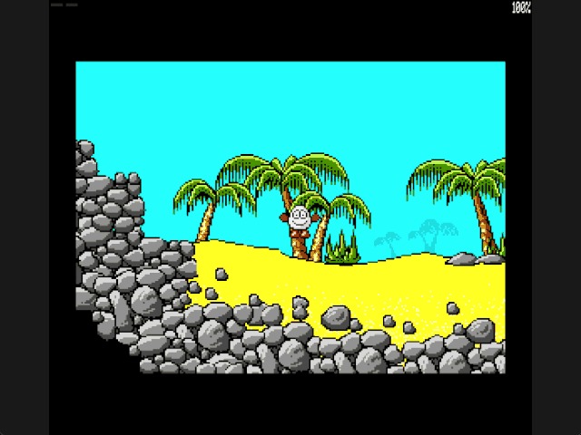

Welcome to the latest in my series of posts on Graphics with the SAM Coupé.

The earlier posts and source examples are available in the [series repository](https://github.com/pjgpetecodes/samcoupegraphics).

# Stopping Dizzy at Solid Scenery

The [previous post](https://github.com/pjgpetecodes/samcoupegraphics/blob/main/assembly/blog12/blog-post.md) composed the starting beach from reusable graphics. Drawing scenery is not the same as making it solid. This post adds one new behaviour: **horizontal collision**.

We use a static preview of the second, cliff-side beach because its rising solid terrain gives us a clear surface to approach. This is not a room-transition lesson: the program starts there and never changes rooms. Ground support, falling, gravity and physical jumping remain separate future steps.

Thank you to Adrian Brown for supplying the graphics and helping with this series. The [asset provenance](https://github.com/pjgpetecodes/samcoupegraphics/blob/main/assembly/blog10/assets/provenance.json) records their extraction from the supplied game with the permission described in Blog 10. Our collision resolver is independently written tutorial code.

## Solidity Is Separate from Colour

The extracted room records mark some graphics as contributing to static collision. Those flags produce a separate packed mask. Each solid pixel is represented by a nibble containing `F`, while an empty pixel is zero.

This mask has the same 128-byte row stride as the display, but it contains **no visible colours**. We do not inspect the displayed sand colour to decide whether movement is legal. A decorative graphic can be drawn without contributing to the mask.

The cliff room's mask occupies physical pages 12-13. It does not overlap reusable graphics in pages 8-9, either screen at 10-11 or 14-15, or the authoritative background in pages 6-7. The layout still fits a 256 KB SAM. `Collision_End` is `0x6000`, and resident code/data end at `0x8FF0`, below the `0xFF00` stack.

## Give the Player a Collision Box

The drawing is 26 pixels wide and 22 rows high. We choose a stable, inset collision box instead of allowing an animated hand or foot to change the collision shape:

```z80
Box_Left:       EQU     4               ; Left inset from the sprite origin
Box_Right:      EQU     21              ; Inclusive right collision edge
Box_Top:        EQU     4               ; Top inset from the sprite origin
Box_Bottom:     EQU     20              ; Inclusive bottom collision edge
```

These are tutorial collision dimensions, not a claim that we have reproduced the original game's exact player box. Left and right edges are inclusive, so the box is 18 pixels wide and 17 rows high.

Y is deliberately fixed at row 87. The box spans rows 91-107, above the rising sand along this demonstration's path; it therefore reaches the actual cliff rather than stopping against the slope near a tree. The decorative trees do not contribute to the collision mask.

**This is an isolated horizontal-collision test, not ground-following movement.** Dizzy deliberately hovers above lower ground here. The next example adds ground contact and changes Y while walking; this example must not be presented as walking on the beach.

## Test the Leading Edge

For a one-pixel step right, the candidate leading column is:

```text
candidate_x + Box_Right
```

For a step left, it is:

```text
candidate_x + Box_Left
```

We inspect every pixel in that column from `Sprite_Row + Box_Top` to `Sprite_Row + Box_Bottom`. Testing only one corner could miss a small obstruction between the corners.

An even pixel selects the high nibble of its mask byte (`F0`); an odd pixel selects the low nibble (`0F`). The address is the row offset plus the pixel X divided by two. Moving down one collision row adds 128.

```z80
Column_Row:     LD      A,(HL)          ; Read the independent solidity mask
                AND     C               ; Test the selected leading-edge nibble
                JR      NZ,Collision_Done ; Do not accept an occupied candidate
                LD      DE,128          ; Advance by one packed map row
                ADD     HL,DE           ; Keep the same leading X
                DJNZ    Column_Row      ; Inspect the complete vertical span
```

This assumes the current box begins in clear space. It prevents entering a new solid column; it is not an embedded-player recovery algorithm.

## Resolve Larger Requests One Pixel at a Time

The pixel-positioning demonstration still alternates one- and three-pixel requests. Testing only the final position could jump over a thin obstacle.

`Constrain_X` retains three separate values:

| State | Purpose |
|---|---|
| `Desired_X` | The bounded position requested by movement |
| `Candidate_X` | The next one-pixel origin being tested |
| `Accepted_X` | The last position whose leading column was empty |

It walks toward the desired position, accepting each clear candidate. On the first solid pixel it stops and returns the last safe position. Screen bounds still clamp the original request, preventing unsigned wrap at the left edge.

Animation remains independent. Holding a direction against a wall can still play the walking animation even though world X no longer changes; moving away works immediately.

## Bank the Collision Map Safely

The collision resolver disables interrupts, maps pages 12-13, and reads only the mask. Executing code, state and the stack stay resident. It restores the complete original LMPR mapping before enabling interrupts again.

The rendering path then restores the hidden page's old rectangle and draws the accepted position using the established odd/even sprite forms. A blocked request does not corrupt either page's previous coordinates or leave scenery trails.

No collision pixels are written to display RAM. There is no new palette dependency or HMPR change.

## Files in This Post

This post's folder starts as a complete copy of the [blog12 folder](https://github.com/pjgpetecodes/samcoupegraphics/tree/main/assembly/blog12), so it builds on its own without reaching into any other folder. The main file is [`15-1.asm`](https://github.com/pjgpetecodes/samcoupegraphics/blob/main/assembly/blog13/15-1.asm).

- **New:** [`collision.asm`](https://github.com/pjgpetecodes/samcoupegraphics/blob/main/assembly/blog13/collision.asm): `Constrain_X`, which stops a horizontal step at the first solid pixel in the solidity mask.
- **Changed:** [`constants.asm`](https://github.com/pjgpetecodes/samcoupegraphics/blob/main/assembly/blog13/constants.asm), [`paged_data.asm`](https://github.com/pjgpetecodes/samcoupegraphics/blob/main/assembly/blog13/paged_data.asm), [`rooms.asm`](https://github.com/pjgpetecodes/samcoupegraphics/blob/main/assembly/blog13/rooms.asm), [`variables.asm`](https://github.com/pjgpetecodes/samcoupegraphics/blob/main/assembly/blog13/variables.asm), [`walking.asm`](https://github.com/pjgpetecodes/samcoupegraphics/blob/main/assembly/blog13/walking.asm). `walking.asm` now calls `Constrain_X` in `collision.asm`.
- **New assets:** `assets/screen-2-collision.bin`.
- Every other file is copied unchanged.

## Source, Disk and Result

The full line-by-line commented example is [15-1.asm](https://github.com/pjgpetecodes/samcoupegraphics/blob/main/assembly/blog13/15-1.asm).

Download [the 15-1 disk](https://github.com/pjgpetecodes/samcoupegraphics/raw/refs/heads/main/disks/15-1.dsk).



The 256 KB SimCoupe recording holds left against solid terrain, moves right to the screen boundary, then returns to the obstruction. X stops changing while the walking animation continues. Space still plays the established roll animation; it does not add a physical jump.

{{emulator:15-1}}

This new disk needs uploading to the site's separate disk-hosting location before the draft's web-emulator embed can run.

## Building and Running

```powershell
python .\.vscode\sam_build.py .\assembly\blog13\15-1.asm --build-only
python .\.vscode\capture_gifs.py 15-1
```

Hold Z or X to move. Z retains priority when both are held. Reset to stop.

## Where to Go Next

A side collision test does not tell us whether there is ground beneath Dizzy. The next post will probe below the collision box and track support while walking. Falling will follow after that, rather than being hidden inside this first collision lesson.
