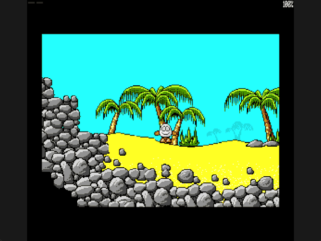
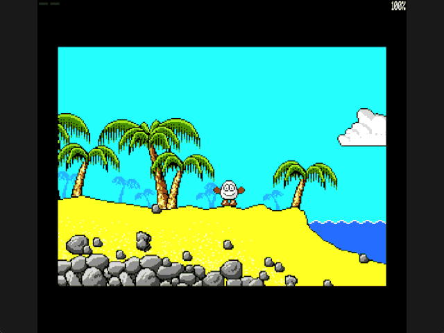

Welcome to the latest in my series of posts on Graphics with the SAM Coupé.

The earlier posts and source examples are available in the [series repository](https://github.com/pjgpetecodes/samcoupegraphics).

# Walking on the Ground

The [previous post](https://github.com/pjgpetecodes/samcoupegraphics/blob/main/assembly/blog13/blog-post.md) deliberately kept Dizzy at a fixed height to isolate side collision. That made him hover over most of the beach. Now we give his feet a supporting surface.

This post teaches **ground contact while walking**: follow the uneven sand, reject a tall wall, and recognise a ledge. Gravity, free falling, physical jumping and room transitions are not included. Two small examples show the same support resolver in different static room previews.

Thank you to Adrian Brown for supplying the graphics and helping with this series. The [asset provenance](https://github.com/pjgpetecodes/samcoupegraphics/blob/main/assembly/blog10/assets/provenance.json) records the source-derived scenery and separate solidity masks. The movement rules below are independently written teaching code, not a reconstruction of the original engine.

## Put the Feet on a Stable Surface

Our cropped drawing remains 26 pixels by 22 rows. We calibrate a narrower, stable footprint around Dizzy's body and feet:

```z80
Box_Left:       EQU     8               ; Left inset from the drawing origin
Box_Right:      EQU     17              ; Inclusive right collision edge
Box_Top:        EQU     4               ; First body row
Box_Bottom:     EQU     20              ; Last body row
Step_Height:    EQU     3               ; Maximum nearby surface adjustment per pixel of X
```

The ten-pixel width replaces the earlier eighteen-pixel test box so that an extended hand does not hold the feet above sloping sand. This remains a tutorial collision shape, independent of whichever animation frame is currently showing.

`Sprite_Y` is now mutable world state. The body must be clear from `Y + 4` through `Y + 20`. The row immediately below it, `Y + 21`, supplies support when at least one selected footprint pixel is solid.

Both tests read the separate static mask in pages 12-13, not the visible scenery or its palette.

## Resolve Walking as Small, Supported Steps

Horizontal requests are still divided into single-pixel candidates. For each candidate X, search from three rows above the current Y to three rows below it:

1. Probe the footprint's support row. Skip positions with nothing underneath.
2. Check the entire body rectangle. Reject positions embedded in sand, rock or another solid surface.
3. Accept the first supported, clear position and store its X and Y.

Searching highest first lets the feet follow a small rise. Searching below the current feet lets them follow a small descent. Testing support before the body avoids scanning a full rectangle for positions that cannot be grounded anyway.

The search is bounded to the playfield and to the last row that fits the complete sprite. It cannot snap Dizzy onto a distant surface. A three-pixel surface adjustment is a deliberate teaching rule, not gravity or an exact copy of the original game.

## A Slope Is Not a Wall

A slope offers a nearby position with ground below and space for the body above. A tall wall does not.

If no nearby supported position fits, we test horizontal movement at the unchanged Y. Solid rock blocks it. Clear space allows it, but sets `Grounded` to zero.

That last case is a ledge. **This lesson intentionally holds Y steady after support is lost.** The yellow border makes that unfinished physical behaviour explicit; it is not presented as grounded walking. Moving back onto reachable sand restores support and the black border. Falling is the next lesson.

The support state can remain unchanged while stationary because these examples have immutable scenery and no moving platforms.

## Check Both Packed Alignments

`Solid_Row` checks only pixels inside the footprint. An even X begins with complete packed bytes. An odd X begins with a low nibble, then complete bytes, then a final high nibble.

Ignoring those partial-byte boundaries could make a neighbouring solid pixel block an otherwise clear body, or falsely claim there is ground under the feet. `Box_Clear` repeats the same row probe over the body's full height.

Interrupts remain disabled while the collision bank replaces the ROM mapping. The resolver restores the saved LMPR before reenabling interrupts. This preserves the established ROM-interrupt and palette conventions.

## Restore the Old Y on Each Screen

Once Y changes, restoring the old X alone leaves trails. Each physical display page now remembers its own previous Y as well:

```z80
Previous_Y_10:  DEFB    Initial_Row     ; Last row drawn on screen 10
Previous_Y_14:  DEFB    Initial_Row     ; Last row drawn on screen 14
```

The hidden page's old X, old Y and old parity select its restoration rectangle. Drawing then uses the new world position. Animation-frame bounds never decide where the ground is.

Resident code/data end at `0x90A7`, clear of the `0xFF00` stack. The existing bank allocation still fits a 256 KB SAM; no new graphics bank is needed.

## Files in This Post

This post's folder starts as a complete copy of the [blog13 folder](https://github.com/pjgpetecodes/samcoupegraphics/tree/main/assembly/blog13), so it builds on its own without reaching into any other folder. The main files are [`16-1.asm`](https://github.com/pjgpetecodes/samcoupegraphics/blob/main/assembly/blog14/16-1.asm) and [`16-2.asm`](https://github.com/pjgpetecodes/samcoupegraphics/blob/main/assembly/blog14/16-2.asm).

- **Moved and changed:** this post rewrites `Constrain_X` so each horizontal step also follows the ground. That makes it part of walking, so it moves into [`walking.asm`](https://github.com/pjgpetecodes/samcoupegraphics/blob/main/assembly/blog14/walking.asm). [`collision.asm`](https://github.com/pjgpetecodes/samcoupegraphics/blob/main/assembly/blog14/collision.asm) now holds the solidity tests that walking, and later gravity, share: `Has_Support`, `Box_Clear` and `Solid_Row`.
- **Changed:** [`constants.asm`](https://github.com/pjgpetecodes/samcoupegraphics/blob/main/assembly/blog14/constants.asm), [`dizzy_sprite.asm`](https://github.com/pjgpetecodes/samcoupegraphics/blob/main/assembly/blog14/dizzy_sprite.asm), [`paged_data.asm`](https://github.com/pjgpetecodes/samcoupegraphics/blob/main/assembly/blog14/paged_data.asm), [`rooms.asm`](https://github.com/pjgpetecodes/samcoupegraphics/blob/main/assembly/blog14/rooms.asm), [`screen_paging.asm`](https://github.com/pjgpetecodes/samcoupegraphics/blob/main/assembly/blog14/screen_paging.asm), [`variables.asm`](https://github.com/pjgpetecodes/samcoupegraphics/blob/main/assembly/blog14/variables.asm), [`walking.asm`](https://github.com/pjgpetecodes/samcoupegraphics/blob/main/assembly/blog14/walking.asm).
- **Only for 16-1:** [`constants_cliff.asm`](https://github.com/pjgpetecodes/samcoupegraphics/blob/main/assembly/blog14/constants_cliff.asm), [`paged_data_cliff.asm`](https://github.com/pjgpetecodes/samcoupegraphics/blob/main/assembly/blog14/paged_data_cliff.asm), [`rooms_cliff.asm`](https://github.com/pjgpetecodes/samcoupegraphics/blob/main/assembly/blog14/rooms_cliff.asm). Each is a copy of the shared file of the same name, with the small change that example needs.
- **New assets:** `assets/screen-1-collision.bin`.
- Every other file is copied unchanged.

## Example 1: Follow the Beach and Meet the Cliff

The [line-by-line commented 16-1.asm](https://github.com/pjgpetecodes/samcoupegraphics/blob/main/assembly/blog14/16-1.asm) starts at X=120, Y=99 in a static preview of screen 2. That initial box is clear and supported.

Download [the 16-1 disk](https://github.com/pjgpetecodes/samcoupegraphics/raw/refs/heads/main/disks/16-1.dsk).



The 256 KB SimCoupe recording shows leftward and rightward surface-following, sustained blocking at the actual cliff, and moving away again. The trees remain decorative.

{{emulator:16-1}}

## Example 2: Recognise the Real Beach Edge

The [line-by-line commented 16-2.asm](https://github.com/pjgpetecodes/samcoupegraphics/blob/main/assembly/blog14/16-2.asm) uses exactly the same resolver. Only the static room/mask and initial height change: screen 1 starts at X=120, Y=106.

Download [the 16-2 disk](https://github.com/pjgpetecodes/samcoupegraphics/raw/refs/heads/main/disks/16-2.dsk).



This recording shows the border changing from black to yellow beyond the sand and back to black on return. No water hazard, falling, death or room transition is implemented.

{{emulator:16-2}}

Both web-emulator placeholders need their disks uploaded to the site's separate disk-hosting location before publication.

## Building and Controls

```powershell
python .\.vscode\sam_build.py .\assembly\blog14\16-1.asm --build-only
python .\.vscode\sam_build.py .\assembly\blog14\16-2.asm --build-only
python .\.vscode\capture_gifs.py 16-1 16-2
```

Hold Z or X to walk; Z still takes priority if both are held. Space retains the earlier animation-only action, not a physical jump. Reset to stop.

The next post will make an unsupported player fall and land, reusing this collision box, support test and per-page X/Y restoration.
