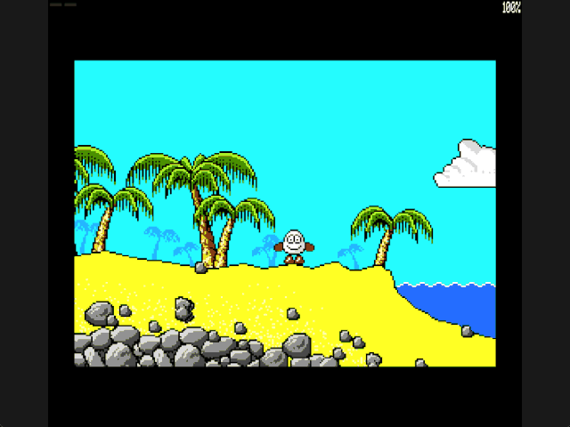

Welcome to the latest in my series of posts on Graphics with the SAM Coupé.

The earlier posts and source examples are available in the [series repository](https://github.com/pjgpetecodes/samcoupegraphics).

# Gravity and Landing

The [ground-contact lesson](https://github.com/pjgpetecodes/samcoupegraphics/blob/main/assembly/blog14/blog-post.md) deliberately left Dizzy at the same height when he walked beyond reachable ground. The yellow border showed that his feet had lost support. Now that state causes a fall.

This post adds **downward acceleration and landing**, not jumping, hazards, death or room transitions. We keep the same starting beach, collision mask, ten-pixel footprint and small-step surface-following.

Thank you to Adrian Brown for supplying the graphics and helping with this series. The [asset provenance](https://github.com/pjgpetecodes/samcoupegraphics/blob/main/assembly/blog10/assets/provenance.json) records the source-derived scenery. These are independently written tutorial physics, not a claim to reproduce the original game's exact movement.

## Velocity Is Separate from Position

`Sprite_Y` tells us where Dizzy is. `Fall_Speed` tells us how far downward he wants to travel during an update.

```z80
Maximum_Fall:   EQU     4               ; Maximum downward pixels per update
Fall_Speed:     DEFB    0               ; Start with no downward velocity
Fall_Remaining: DEFB    0               ; One-pixel candidates left to resolve
```

When unsupported, speed increases by one each completed update, capped at four. The requested distances are therefore one, two, three, four, four, and so on. These are update-based teaching constants, not a measured real-world acceleration. Rendering may take more than one physical interrupt, so `HALT` alone does not establish an exact 50 physics updates per second.

The program begins at X=120, Y=70, in clear sky, so gravity also works without a direction key being held. Once on the beach, walking continues to use the previous lesson's bounded surface-following.

## Update Gravity Even While Idle

The main loop resolves horizontal movement, applies gravity, then chooses and updates animation. Releasing Z and X must not pause a fall.

The gravity routine maps the existing collision pages with interrupts disabled. It probes directly beneath the current footprint. If there is support, it marks the player grounded and clears fall speed. Otherwise it marks the player airborne and accelerates.

Airborne horizontal movement checks body clearance at the current height. It deliberately skips the nearby-ground search: snapping an airborne player upward onto a platform would undermine the vertical collision resolver.

## Resolve Each Downward Pixel

Testing only `Y + Fall_Speed` could skip a thin platform. Instead, `Fall_Remaining` counts individual one-row candidates.

For each candidate, `Box_Clear` checks the complete body rectangle. If it fits, accept that row and call `Has_Support` beneath the new feet. Stop immediately on contact; otherwise resolve the next pixel until the update's velocity is consumed.

The last accepted position stays above the first solid surface. Landing sets `Grounded` and clears `Fall_Speed`, so stepping off another ledge starts a fresh fall rather than reusing old velocity.

This works at either packed-pixel alignment because both probes reuse the preceding post's nibble-aware row checks.

## Keep the Drawing Inside the Screen

The last complete sprite origin is row 170. Reaching it without support stops downward travel at the bitmap boundary, clears accumulated speed, and leaves the player unsupported. It does not invent an invisible floor or a death state. Room exits and death handling are later lessons.

The starting beach has lower solid terrain beneath its visible water. In this example Dizzy can land on that terrain: water is **not yet a hazard**. Do not interpret that teaching simplification as a reproduction of the original game's swimming or snorkel rules.

## Draw the Final Position

Horizontal movement now returns without drawing. Gravity draws once after resolving the final X/Y; animation changes can still request a fresh drawing.

The existing per-page previous X/Y state restores the correct old rectangle before drawing. ROM is restored before interrupts are enabled and before the next `HALT`. No new bank is needed; resident code/data remain below the stack, with the assembler enforcing the existing resident-memory limit.

The border remains a useful diagnostic: yellow while airborne, black while supported.

## Files in This Post

This post's folder starts as a complete copy of the [blog14 folder](https://github.com/pjgpetecodes/samcoupegraphics/tree/main/assembly/blog14), so it builds on its own without reaching into any other folder. The main file is [`17-1.asm`](https://github.com/pjgpetecodes/samcoupegraphics/blob/main/assembly/blog15/17-1.asm).

- **New:** [`jump_gravity.asm`](https://github.com/pjgpetecodes/samcoupegraphics/blob/main/assembly/blog15/jump_gravity.asm): gravity and landing.
- **Changed:** [`constants.asm`](https://github.com/pjgpetecodes/samcoupegraphics/blob/main/assembly/blog15/constants.asm), [`variables.asm`](https://github.com/pjgpetecodes/samcoupegraphics/blob/main/assembly/blog15/variables.asm), [`walking.asm`](https://github.com/pjgpetecodes/samcoupegraphics/blob/main/assembly/blog15/walking.asm).
- Every other file is copied unchanged.

## Source, Disk and Result

Read the [line-by-line commented 17-1.asm](https://github.com/pjgpetecodes/samcoupegraphics/blob/main/assembly/blog15/17-1.asm), or download [the 17-1 disk](https://github.com/pjgpetecodes/samcoupegraphics/raw/refs/heads/main/disks/17-1.dsk).



The 256 KB SimCoupe recording shows leaving the upper beach, falling with a yellow border, landing with a black border, and moving back along the solid surface. The initial stationary fall occurs during startup, before this recording begins.

{{emulator:17-1}}

The web-emulator placeholder needs its disk uploaded to the site's separate disk-hosting location before publication.

```powershell
python .\.vscode\sam_build.py .\assembly\blog15\17-1.asm --build-only
python .\.vscode\capture_gifs.py 17-1
```

Z and X move; Z retains priority when both are held. Space still selects an animation-only action, not a physical jump. Reset to stop.

Next we will give a grounded player an upward jump impulse and resolve ceilings, without letting a held Space key cause repeated jumps on landing.
