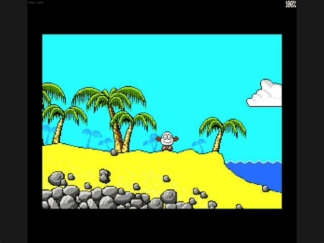

Welcome to the latest in my series of posts on Graphics with the SAM Coupé.

The earlier posts and source examples are available in the [series repository](https://github.com/pjgpetecodes/samcoupegraphics).

# A Physical Jump

The [gravity lesson](https://github.com/pjgpetecodes/samcoupegraphics/blob/main/assembly/blog15/blog-post.md) gave Dizzy downward velocity and safe landings. This post lets a grounded player launch upward and collide with a ceiling.

The new concept is **physical jumping**. Space now changes velocity rather than merely choosing a roll or sideways-jump animation. Z and X still control horizontal movement, including while airborne. There are no items, hazards or room transitions yet.

Thank you to Adrian Brown for supplying the graphics and helping with this series. The [asset provenance](https://github.com/pjgpetecodes/samcoupegraphics/blob/main/assembly/blog10/assets/provenance.json) records the source-derived scenery. Our jump impulse and air control are teaching choices, not a claim to reproduce the original game's exact physics.

## Detect a Press, Not a Held Key

Space is bit zero of the active-low keyboard row at `0x7FFE`. `Space_Previous` stores that single bit from the preceding update.

A jump requires both a released-to-pressed transition and `Grounded` set. We update the remembered bit even in mid-air. An airborne press is consumed, not queued for landing.

This prevents two unwanted behaviours: repeated jumps while Space stays held, and a delayed jump caused by pressing Space before landing. Release and press again after landing to jump again.

## Share One Signed Velocity

`Fall_Speed` becomes a signed eight-bit vertical velocity. Positive values mean downward; negative values mean upward.

```z80
Jump_Impulse:   EQU     246             ; Two's-complement minus ten
```

On a valid press we clear `Grounded` and store the impulse. Downward acceleration still adds one each update. The first upward request is therefore nine pixels, then eight, seven, and so on until the apex. Downward speed remains capped at four.

These are distances per completed update, not per animation frame or a guaranteed physical interrupt interval. The arc lasts independently of the jump image sequence.

## Leave the Ground Before Probing Support

Read jump input before resolving horizontal movement. Clearing `Grounded` disables the nearby-ground search while launching.

The vertical resolver checks the velocity sign before checking support beneath the feet. Otherwise the sand that enabled the jump would immediately cancel its upward impulse.

For negative velocity, apply acceleration, convert the remaining negative value to a positive upward pixel count, and test candidates one row at a time. At zero velocity, remain airborne at the apex; the next update begins downward acceleration.

## Stop at a Ceiling Without Grounding

Each upward candidate uses the existing full-body `Box_Clear` probe. Accept only entirely clear positions. On the first collision, retain the previous safe Y and clear upward speed.

Crucially, a ceiling does **not** set `Grounded`. Gravity begins pulling Dizzy downward on the next update. The upper playfield limit at row 48 also stops upward motion without inventing a landing.

Downward collision and landing remain the previous lesson's pixel-by-pixel resolver.

## Animation Follows the Jump

A valid launch selects a left-facing jump sequence when Z is held; otherwise it selects the existing right-facing sequence, including for a vertical jump. Horizontal input retains Z priority.

While airborne, ordinary walking selection does not override the jump image. If the sequence ends before landing, the existing idle sequence can display while physics continues. Landing selects walking or idle from the held direction.

Space no longer starts the old animation-only roll. That intentional control change is what separates this physical-jump lesson from the earlier animation demonstrations.

## Files in This Post

This post's folder starts as a complete copy of the [blog15 folder](https://github.com/pjgpetecodes/samcoupegraphics/tree/main/assembly/blog15), so it builds on its own without reaching into any other folder. The main files are [`18-1.asm`](https://github.com/pjgpetecodes/samcoupegraphics/blob/main/assembly/blog16/18-1.asm) and [`18-2.asm`](https://github.com/pjgpetecodes/samcoupegraphics/blob/main/assembly/blog16/18-2.asm).

- **New:** [`test_ceiling.asm`](https://github.com/pjgpetecodes/samcoupegraphics/blob/main/assembly/blog16/test_ceiling.asm): an artificial black bar used only to test upward collision.
- **Changed:** [`constants.asm`](https://github.com/pjgpetecodes/samcoupegraphics/blob/main/assembly/blog16/constants.asm), [`dizzy_sprite.asm`](https://github.com/pjgpetecodes/samcoupegraphics/blob/main/assembly/blog16/dizzy_sprite.asm), [`jump_gravity.asm`](https://github.com/pjgpetecodes/samcoupegraphics/blob/main/assembly/blog16/jump_gravity.asm), [`variables.asm`](https://github.com/pjgpetecodes/samcoupegraphics/blob/main/assembly/blog16/variables.asm).
- Every other file is copied unchanged.

## Example 1: Jump, Hold, Release and Jump Again

Read the [line-by-line commented 18-1.asm](https://github.com/pjgpetecodes/samcoupegraphics/blob/main/assembly/blog16/18-1.asm), or download [the 18-1 disk](https://github.com/pjgpetecodes/samcoupegraphics/raw/refs/heads/main/disks/18-1.dsk).



The 256 KB SimCoupe recording shows three accepted jumps: a long held press produces one jump, the next fresh press produces another while an additional airborne press is ignored, and a final fresh press with X produces a rightward jump. Yellow marks airborne state; black marks landing.

{{emulator:18-1}}

## Example 2: An Explicit Ceiling Fixture

The starting beach has no convenient overhead solid surface at the spawn. Rather than silently changing the collision properties of a decorative tree, [18-2.asm](https://github.com/pjgpetecodes/samcoupegraphics/blob/main/assembly/blog16/18-2.asm) adds a clearly artificial black test bar.

The bar spans pixels 110-173, rows 85-87. Startup writes it into both the authoritative scenery and the separate collision mask before copying scenery to the display pages. It is not original game geometry and must not be copied into the faithful final rooms.

The resolver itself is unchanged. The shorter jump stops beneath the bar and falls back onto the beach. Holding Space through that landing still does not launch another jump.

Download [the 18-2 disk](https://github.com/pjgpetecodes/samcoupegraphics/raw/refs/heads/main/disks/18-2.dsk).


Both accepted launches and returns were inspected in the 256 KB SimCoupe recording. Resident code/data end at `0x9166` for the beach and `0x9190` for the fixture example, below the `0xFF00` stack.

{{emulator:18-2}}

Both web-emulator placeholders need their disks uploaded to the site's separate disk-hosting location before publication.

## Build and Controls

```powershell
python .\.vscode\sam_build.py .\assembly\blog16\18-1.asm --build-only
python .\.vscode\sam_build.py .\assembly\blog16\18-2.asm --build-only
python .\.vscode\capture_gifs.py 18-1 18-2
```

Z/X move, Space jumps on a fresh grounded press, and reset stops the program.

Next we will connect the first two rooms, replacing scenery and collision together and choosing safe entry positions without bypassing the cliff's later chest puzzle.
