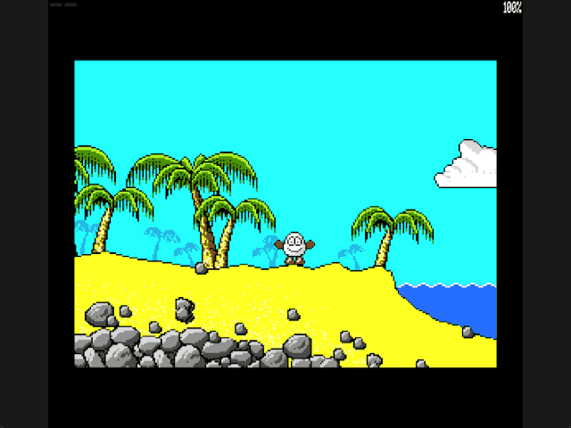

Welcome to the latest in my series of posts on Graphics with the SAM Coupé.

The earlier posts and source examples are available in the [series repository](https://github.com/pjgpetecodes/samcoupegraphics).

# Connecting the First Two Screens

The [jumping lesson](https://github.com/pjgpetecodes/samcoupegraphics/blob/main/assembly/blog16/blog-post.md) finished our initial movement and collision work. Now we connect the starting beach to the cliff-side beach.

This post adds **room transitions**, not collectables or the chest escape. Only the first two screens are connected. Screen 2's cliff remains solid, and there is no upward exit yet.

Thank you to Adrian Brown for supplying the graphics and helping with this series. The [asset provenance](https://github.com/pjgpetecodes/samcoupegraphics/blob/main/assembly/blog10/assets/provenance.json) records the verified scenery and collision masks. Our transition code is independently written.

## Explicit Links and Safe Entries

Do not assume four rooms are consecutive numbers. The recovered route eventually goes left from native room 77 to 76, then up to 108; this lesson only uses the first link and its return.

The tutorial stores screen IDs 1 and 2 in `Current_Room`. Holding Z at screen 1's left edge selects screen 2. Holding X at screen 2's right edge selects screen 1.

| Destination | Entry X | Entry Y |
|---|---|---|
| Screen 2, cliff beach | 230 | 97 |
| Screen 1, starting beach | 0 | 98 |

Both entry boxes were checked against their matching masks: the body is clear and the feet have support.

These first links are deliberately **walking-only**. The player must be grounded at the boundary. An airborne player stays in the current room until landing; we do not silently teleport a jump onto a new floor. Unlinked edges remain bounded.

## Replace Scenery and Collision Together

`Current_Room` selects both the existing compact draw list and the matching static collision stream. Mixing one room's visible scenery with another room's solidity would make decorative locations block movement or allow walking through rock.

The source graphics remain in pages 8-9, authoritative scenery in 6-7 and active collision in 12-13. Both rooms reuse those buffers.

There is not enough spare space in a 256 KB design to keep every full 24 KB mask resident alongside our graphics and screens. The extractor therefore also emits `room-collision.asm`: runs of a little-endian word count and one repeated packed solidity byte, followed by a zero count.

For example, a long stretch of empty sky needs only a count and a zero byte, rather than thousands of zeros. The four masks use 2,810 bytes including terminators. Only two are selected in this lesson; preparing data for later rooms does not connect them.

`Load_Collision` expands the selected stream into pages 12-13. Generated streams each expand to exactly `0x6000` bytes; round-trip checks compare every expanded byte with its raw mask. This small loader is room-storage plumbing, not a new collision rule.

## Keep the Old Room Visible Until the New One Is Ready

During entry, disable interrupts before mapping banks. Discard the old pending-frame flag and reset downward speed for the supported entry.

Compose the new authoritative scenery, then decode its collision mask. The old displayed room stays untouched during both operations.

Next, copy complete new scenery to the hidden display pair. Only after that copy finishes do we change VMPR to reveal it. Then initialize the no-longer-visible other screen too. There is no scrolling effect and no intentional display of a partially composed room.

The transition is a loading pause, not an ordinary movement update. Palette interrupt handling resumes after ROM is restored.

## Reset Per-Page Restoration State

Both fresh screens contain scenery, not the old room's player. Reset both saved X values and both saved Y values to the new entry. Subsequent physics and animation draw on the hidden page using the established restoration path.

The sprite frame cache remains valid because frame graphics do not change between rooms. The Space edge latch is also retained: holding Space during entry must not manufacture a fresh press.

Resident code/data end at `0x9D16`, below the existing `0xC000` assertion and `0xFF00` stack. The entire design still runs on a 256 KB SAM.

## Files in This Post

This post's folder starts as a complete copy of the [blog16 folder](https://github.com/pjgpetecodes/samcoupegraphics/tree/main/assembly/blog16), so it builds on its own without reaching into any other folder. The main file is [`19-1.asm`](https://github.com/pjgpetecodes/samcoupegraphics/blob/main/assembly/blog17/19-1.asm).

- **Changed:** [`collision.asm`](https://github.com/pjgpetecodes/samcoupegraphics/blob/main/assembly/blog17/collision.asm), [`paged_data.asm`](https://github.com/pjgpetecodes/samcoupegraphics/blob/main/assembly/blog17/paged_data.asm), [`rooms.asm`](https://github.com/pjgpetecodes/samcoupegraphics/blob/main/assembly/blog17/rooms.asm), [`variables.asm`](https://github.com/pjgpetecodes/samcoupegraphics/blob/main/assembly/blog17/variables.asm), [`walking.asm`](https://github.com/pjgpetecodes/samcoupegraphics/blob/main/assembly/blog17/walking.asm).
- **New assets:** `assets/room-collision.asm`.
- Every other file is copied unchanged.

## Source, Disk and Result

Read the [line-by-line commented 19-1.asm](https://github.com/pjgpetecodes/samcoupegraphics/blob/main/assembly/blog17/19-1.asm), or download [the 19-1 disk](https://github.com/pjgpetecodes/samcoupegraphics/raw/refs/heads/main/disks/19-1.dsk).



The 256 KB SimCoupe recording shows travelling left into screen 2 and returning right into screen 1, with grounded movement continuing after the scenery changes. The cliff remains part of screen 2's solid mask.

{{emulator:19-1}}

The web-emulator placeholder needs its disk uploaded to the site's separate disk-hosting location before publication.

```powershell
python .\.vscode\sam_build.py .\assembly\blog17\19-1.asm --build-only
python .\.vscode\capture_gifs.py 19-1
```

Z/X move and Space performs a fresh-press grounded jump. Reset to stop.

The next post adds the chest to screen 1 and handles Enter pickup. Collection state comes first; visible inventory and physically dropping the chest to escape follow in separate lessons.
