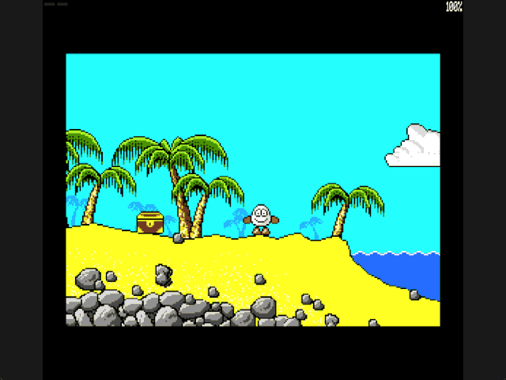

Welcome to the latest in my series of posts on Graphics with the SAM Coupé.

The earlier posts and source examples are available in the [series repository](https://github.com/pjgpetecodes/samcoupegraphics).

# Collecting the Chest

The [previous post](https://github.com/pjgpetecodes/samcoupegraphics/blob/main/assembly/blog17/blog-post.md) connected the first two screens. Now we introduce one persistent world item: the chest on the starting beach.

This post teaches **Enter pickup and collection state**. A visible three-slot inventory comes next; dropping the chest and using it to escape screen 2 follow afterward. Carrying the chest does not unlock anything in this example.

Thank you to Adrian Brown for supplying the graphics and helping with this series. The [chest asset provenance](https://github.com/pjgpetecodes/samcoupegraphics/blob/main/assembly/blog18/assets/provenance.json) records source graphic 215, extracted independently from its graphics-table pointer. Only its dimensions and pixels are exported, not original game code.

## An Item Is Not Part of the Static Room

The chest starts at source byte X=24, row Y=111. Its drawing is twenty pixels wide and sixteen rows high. We place it after static scenery using the existing transparent compositor.

`Chest_Collected` is a resident byte, initially zero. `Build_Chest` draws the item only when the current room is screen 1 and that byte is still zero.

The chest is not added to the collision mask. This is a collectable world image, not the solid support created by the later placement puzzle.

## Enter Is a Separate Action

Enter is read from bit zero of keyboard row `0xBFFE`, active low. `Enter_Previous` remembers the preceding update's bit, just as the jump lesson remembers Space.

Collection requires a fresh released-to-pressed edge, a grounded player, and both Z and X released. An invalid press is consumed rather than queued. Holding Enter cannot repeatedly collect the same item.

The SimCoupe test exercises the actual Enter mapping, not a substituted action key.

## Require Nearby Rectangle Overlap

The stable player box must overlap the chest rectangle: pixels 48-67 and rows 111-126. We compare inclusive player edges against the item's exclusive far limits.

An Enter press from the initial position does nothing. Releasing the key, walking over the chest, stopping and pressing again can collect it. A distant or airborne press cannot grant the item.

This overlap rule is deliberately explicit tutorial behaviour, rather than a claim to reproduce every proximity rule in the original game.

## Store State Before Rebuilding

On collection, set `Chest_Collected` to one before rebuilding the current room at the same supported position. Both display pages receive scenery without the chest, and their previous X/Y state is reset using the established room-refresh path.

Erasing the chest on one screen alone would let it reappear when the other screen flips into view. Erasing pixels without changing state would let a later room rebuild recreate it.

The resident byte persists while travelling between screens. Revisiting screen 1 therefore keeps the chest absent, and a second collection attempt cannot duplicate it. Resetting the program restores the initial state.

For now this byte is the entire single-item carried state. It is not a general inventory and it does not solve the cliff puzzle.

## Files in This Post

This post's folder starts as a complete copy of the [blog17 folder](https://github.com/pjgpetecodes/samcoupegraphics/tree/main/assembly/blog17), so it builds on its own without reaching into any other folder. The main file is [`20-1.asm`](https://github.com/pjgpetecodes/samcoupegraphics/blob/main/assembly/blog18/20-1.asm).

- **New:** [`items_inventory.asm`](https://github.com/pjgpetecodes/samcoupegraphics/blob/main/assembly/blog18/items_inventory.asm): collecting and dropping items.
- **Changed:** [`paged_data.asm`](https://github.com/pjgpetecodes/samcoupegraphics/blob/main/assembly/blog18/paged_data.asm), [`rooms.asm`](https://github.com/pjgpetecodes/samcoupegraphics/blob/main/assembly/blog18/rooms.asm), [`variables.asm`](https://github.com/pjgpetecodes/samcoupegraphics/blob/main/assembly/blog18/variables.asm).
- **New assets:** `assets/image-215.bin`.
- Every other file is copied unchanged.

## Source, Disk and Result

Read the [line-by-line commented 20-1.asm](https://github.com/pjgpetecodes/samcoupegraphics/blob/main/assembly/blog18/20-1.asm), or download [the 20-1 disk](https://github.com/pjgpetecodes/samcoupegraphics/raw/refs/heads/main/disks/20-1.dsk).



The 256 KB SimCoupe recording first presses Enter too far away, then collects while overlapping the chest, holds the key, visits screen 2 and returns. The chest stays absent on the starting beach.

Resident code/data end at `0x9D9E`; graphics including the chest end at `0x75C9` in pages 8-9. Both remain within their asserted bounds.

{{emulator:20-1}}

The web-emulator placeholder needs its disk uploaded to the site's separate disk-hosting location before publication.

```powershell
python .\.vscode\sam_build.py .\assembly\blog18\20-1.asm --build-only
python .\.vscode\capture_gifs.py 20-1
```

Z/X move, Space jumps on a fresh grounded press, and Enter collects while stopped on the ground. Reset to stop.

Next we replace this single collected byte with the requested three-item LIFO stack and show all three inventory slots at the top of the screen.
