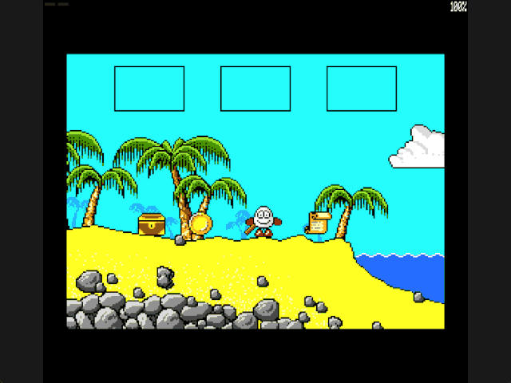
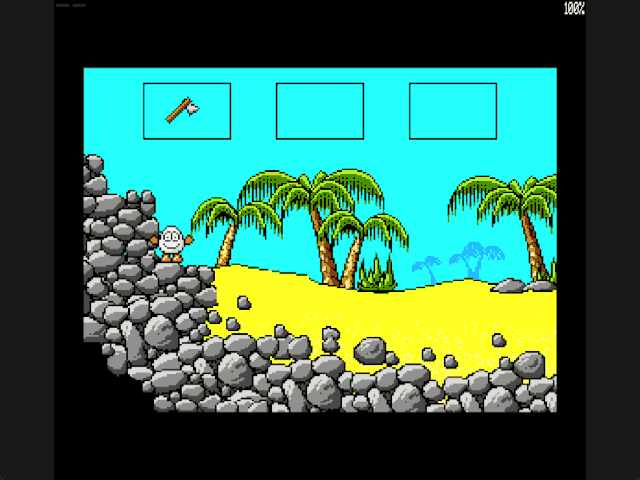

Welcome to the latest in my series of posts on Graphics with the SAM Coupé.

The earlier posts and source examples are available in the [series repository](https://github.com/pjgpetecodes/samcoupegraphics).

# A Visible Three-Item Stack

The [chest-pickup lesson](https://github.com/pjgpetecodes/samcoupegraphics/blob/main/assembly/blog18/blog-post.md) stored a single collected byte. Now we replace it with the requested **three-item LIFO inventory**, visible at the top of the screen.

This lesson covers inventory order, capacity and safe dropping. The chest placement puzzle remains separate: dropping a chest here does not create a platform or unlock an exit.

Thank you to Adrian Brown for supplying the graphics and helping with this series. The [additional asset provenance](https://github.com/pjgpetecodes/samcoupegraphics/blob/main/assembly/blog19/assets/provenance.json) records the coin, axe and scroll graphics. The [chest provenance](https://github.com/pjgpetecodes/samcoupegraphics/blob/main/assembly/blog18/assets/provenance.json) remains unchanged.

**Intentional adaptation:** the original game's item routine rotates slots and drops an older item. This tutorial follows the requested stack instead: first in, last out. Do not describe that LIFO rule as an exact reproduction of the original.

## Separate World Records from Carried Identifiers

Four eight-byte records contain a tutorial item identifier, graphics pointer, byte X, Y, packed width, height and room ID. Room 255 means carried; rooms 1 and 2 mean physically present in the world.

The chest retains its recovered placement. The coin, axe and scroll positions are **teaching fixtures**, not original placements or puzzle prerequisites. Four available items let us exercise a capacity of three.

`Inventory_Slots` holds three identifiers, initially 255 for empty. `Inventory_Count` ranges from zero to three. Slots fill left to right, oldest to newest, so the rightmost occupied slot is the top.

Picking up an item appends its identifier and marks its world record carried. Dropping uses slot `count - 1`, never slot zero. Thus collecting axe, coin, chest produces removals in the order chest, coin, axe.

## Enter Keeps One Clear Meaning

Enter remains a fresh-press, grounded, stationary action. Invalid airborne or moving presses are consumed, not queued.

Search nearby world items first using rectangle overlap and stable record order. If an item is nearby, try to pick it up. A full inventory rejects that pickup; it does not discard an older item or unexpectedly drop the current top.

Only when no item is nearby does Enter try to drop the stack top. An empty stack rejects the action. Rejections produce a short amber border pulse; normal black/yellow support feedback resumes afterward.

This precedence means pressing Enter again over an item just dropped normally picks it back up. Move to a clear position before trying to drop the next carried item.

## Commit a Pop Only After Safe Placement

A drop aligns the drawing to a screen byte near the player's centre and searches a small vertical neighbourhood near the feet. It requires the complete item rectangle to fit above solid support in the existing static mask.

The check uses that item's own width and height, not the player's narrower body box. It conservatively requires even transparent drawing margins to be clear. That can reject a close placement that appears visually possible, but it never silently embeds the item in terrain.

The proposed rectangle and its support row must remain inside the bitmap. If every nearby candidate fails, leave the count, slots and world record unchanged.

Only a successful placement updates the world X/Y and room, decreases the count and clears the vacated slot. This ordering prevents a failed drop from losing an item. Ordinary dropped items remain non-solid; becoming a supporting chest is the next puzzle lesson.

## Draw Every Slot at the Screen Top

The reserved HUD area occupies rows 0-47. We draw three black-outlined frames there, including empty frames. Occupied slots show the corresponding source graphic, not an anonymous flag. The playfield and its collision coordinates remain unchanged.

The HUD and world items are composed into authoritative scenery. A successful push or pop refreshes both physical display pages through the existing room-refresh path. Empty slots cannot retain stale icons on alternating frames.

Records, slots and count remain resident across room transitions. Reset restores the authored initial item placements and empties the inventory.

## Files in This Post

This post's folder starts as a complete copy of the [blog18 folder](https://github.com/pjgpetecodes/samcoupegraphics/tree/main/assembly/blog18), so it builds on its own without reaching into any other folder. The main files are [`21-1.asm`](https://github.com/pjgpetecodes/samcoupegraphics/blob/main/assembly/blog19/21-1.asm) and [`21-2.asm`](https://github.com/pjgpetecodes/samcoupegraphics/blob/main/assembly/blog19/21-2.asm).

- **Changed:** [`items_inventory.asm`](https://github.com/pjgpetecodes/samcoupegraphics/blob/main/assembly/blog19/items_inventory.asm), [`paged_data.asm`](https://github.com/pjgpetecodes/samcoupegraphics/blob/main/assembly/blog19/paged_data.asm), [`rooms.asm`](https://github.com/pjgpetecodes/samcoupegraphics/blob/main/assembly/blog19/rooms.asm), [`variables.asm`](https://github.com/pjgpetecodes/samcoupegraphics/blob/main/assembly/blog19/variables.asm), [`walking.asm`](https://github.com/pjgpetecodes/samcoupegraphics/blob/main/assembly/blog19/walking.asm).
- **Only for 21-2:** [`constants_drop_test.asm`](https://github.com/pjgpetecodes/samcoupegraphics/blob/main/assembly/blog19/constants_drop_test.asm), [`variables_drop_test.asm`](https://github.com/pjgpetecodes/samcoupegraphics/blob/main/assembly/blog19/variables_drop_test.asm). Each is a copy of the shared file of the same name, with the small change that example needs.
- **New assets:** `assets/image-211.bin`, `assets/image-216.bin`, `assets/image-231.bin`.
- Every other file is copied unchanged.

## Example 1: Push, Fill, Reject and Pop

Read the [line-by-line commented 21-1.asm](https://github.com/pjgpetecodes/samcoupegraphics/blob/main/assembly/blog19/21-1.asm), or download [the 21-1 disk](https://github.com/pjgpetecodes/samcoupegraphics/raw/refs/heads/main/disks/21-1.dsk).



The 256 KB SimCoupe recording shows axe, coin and chest pushed in that order. Trying to collect the fourth item while full produces rejection feedback without changing the slots. Moving to clear positions then drops chest, coin and axe, leaving three visibly empty frames. A later empty-stack action is rejected.

{{emulator:21-1}}

## Example 2: An Unsafe Drop Must Retain the Item

Read [21-2.asm](https://github.com/pjgpetecodes/samcoupegraphics/blob/main/assembly/blog19/21-2.asm), or download [the 21-2 disk](https://github.com/pjgpetecodes/samcoupegraphics/raw/refs/heads/main/disks/21-2.dsk).

This is an isolated fixture using the **same inventory engine**. It starts at the cliff with one preloaded axe, explicitly rather than pretending a pickup has occurred. The narrower player body fits there, but the wider proposed axe rectangle intersects rock.



The live recording shows the rejection pulse with the axe still in its slot, then a successful drop after moving away from the cliff. The seeded axe is marked carried from startup, so it is not also duplicated in the world.

{{emulator:21-2}}

Resident code/data end at `0x9F7B`; banked graphics end at `0x77CA`. Both examples fit the existing 256 KB layout and keep the stack at `0xFF00`.

Both web-emulator placeholders need their disks uploaded to the site's separate disk-hosting location before publication.

```powershell
python .\.vscode\sam_build.py .\assembly\blog19\21-1.asm --build-only
python .\.vscode\sam_build.py .\assembly\blog19\21-2.asm --build-only
python .\.vscode\capture_gifs.py 21-1 21-2
```

Z/X move, Space jumps, and Enter picks up nearby items or drops the newest carried item while stopped on the ground. Reset to stop.

Next we remove the extra inventory-demo placements from the faithful route and connect a physical chest placement on screen 2 to its supporting platform. Merely carrying the chest will still not solve that puzzle.
