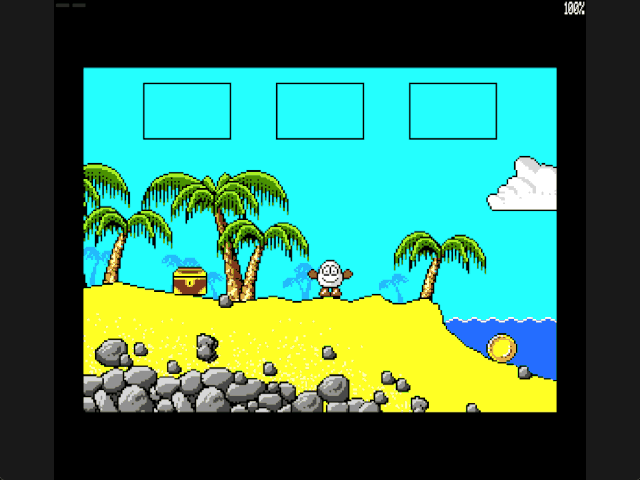

Welcome to the latest in my series of posts on Graphics with the SAM Coupé.

The earlier posts and source examples are available in the [series repository](https://github.com/pjgpetecodes/samcoupegraphics).

# Put the Chest Down to Escape

The [inventory lesson](https://github.com/pjgpetecodes/samcoupegraphics/blob/main/assembly/blog19/blog-post.md) gave us a visible three-item stack and safe dropping. Now a **physical chest placement** changes screen 2.

Carrying the chest is not enough. Drop it in the recovered trigger area, create the supporting chest, jump onto it, then jump upward to the sparse next screen.

This lesson necessarily reveals screen 3 as the escape destination. It does not connect screen 4 or the rest of the sky route; that is the next room-expansion post.

Thank you to Adrian Brown for supplying the graphics and helping with this series. The [room provenance](https://github.com/pjgpetecodes/samcoupegraphics/blob/main/assembly/blog10/assets/provenance.json), [chest provenance](https://github.com/pjgpetecodes/samcoupegraphics/blob/main/assembly/blog18/assets/provenance.json) and [coin provenance](https://github.com/pjgpetecodes/samcoupegraphics/blob/main/assembly/blog19/assets/provenance.json) identify the permitted source graphics. Original engine analysis remains private; this is independently written tutorial code.

## Remove the Inventory Test Placements

The extra axe, coin and scroll placements from the previous post were explicit fixtures. They are not part of this faithful route.

The chest retains its recovered screen-1 position. The coin now uses its recovered byte X=108, Y=148. A second coin record is prepared for screen 4 but cannot be reached yet. Three inventory slots remain visible even when only one item is carried.

Our requested LIFO order remains an intentional difference from the original game's slot rotation.

## Reproduce the Physical Trigger, Not a Carried Flag

The recovered source searches for an actual dropped chest overlapping a screen-2 rectangle. In byte coordinates, it tests:

```text
chest_left < 31
chest_left + chest_width >= 21
chest_top < 112
chest_top + chest_height >= 100
```

These mixed exclusive/inclusive comparisons deliberately match the recovered consumer. Screen ID and chest identity must also match. Merely putting an identifier in inventory cannot satisfy them.

On activation, the source removes the loose chest and enables a stationary supporting actor at byte X=24, Y=95. Our tutorial consumes the loose world item and stores persistent `Chest_Placed` state, but deliberately keeps the chest at its actual dropped position rather than snapping it to that source actor's fixed coordinates.

## Keep Activation Safe

A successful drop must still pass the previous lesson's clear-rectangle and support checks. Anchor it at the stopped player's collision footprint, align to a packed screen byte, and search only the same small vertical neighbourhood for supporting ground. Clamp the horizontal anchor only if the complete item would cross the bitmap boundary.

Walk left to the cliff, release the direction key and press Enter **without moving right first**. The chest appears at Dizzy's feet. Its accepted byte X and top row remain in the world record and supply both its drawing position and its supporting surface; activation does not relocate it.

If placement fails, the inventory remains unchanged and the rejection pulse appears. There is no teleport of either player or chest and no silent item loss.

## Draw and Support at the Actual Drop Position

After activation, room composition draws the source chest graphic at the accepted `World_Items` coordinates. `Has_Support` checks that same twenty-pixel span and top row after checking ordinary terrain.

The chest is an explicit **one-way supporting top**, not a new solid rectangle painted through Dizzy. A jump can pass upward through it; falling feet stop on its top. Dropping at the current stance therefore neither embeds nor lifts Dizzy, and the next straight jump can land on the chest without a sideways manoeuvre. This simple support rule and preserving the actual drop coordinates are tutorial adaptations, not a claim to reproduce every original actor rule.

`Chest_Placed` survives room changes. Returning to screen 2 rebuilds the visible chest at the same saved position, with the same supporting top. The consumed loose chest cannot be collected a second time.

## Calibrate the Jump to the Obstacle

The jump impulse is now signed minus eight instead of minus ten. With the established one-unit downward acceleration, the unobstructed rise is:

```text
7 + 6 + 5 + 4 + 3 + 2 + 1 = 28 pixels
```

This level calibration matters. The nearby beach origin is around row 87, so a 28-pixel rise cannot reach the upper exit at row 48. A wall-side drop rests with its top around row 92, putting the supported player origin around row 71; now the same jump can reach that boundary.

The local upward exit also requires `Chest_Placed` and stays within the leftmost 48 pixels of the room. It must not require Dizzy to remain directly above the chest: the escape jump travels **left over the wall**. A carried flag never opens it.

Ground walking retains the established alternating one-/three-pixel cadence. Airborne directional movement uses four pixels per completed update, still resolved one pixel at a time against the mask. That horizontal reach lets Dizzy clear the cliff and reach the tiny lower-left rock before falling; it does not increase the 28-pixel vertical rise.

Remember the last facing direction for a neutral jump. Holding Z selects the existing left-jump frames, holding X selects the right-jump frames, and releasing the direction key must not arbitrarily turn a left-facing jump to the right.

## Reveal the Sparse Third Screen

The recovered route goes up from native room 76 to 108, not left into another beach. The destination uses the real sparse room graphics and collision mask.

Keep X unchanged and add 100 to the current Y when crossing upward. The hundred-row offset is recovered from the original room-change routine. Entering around row 148 places Dizzy near the bottom of screen 3, **below the clouds**, not on an artificial cloud-top spawn.

Preserve signed vertical speed and finish the current update's remaining pixels after rebuilding the destination. This remains one jump, not a second launch. The tutorial triggers its wrap at drawing-origin row 48 to keep the complete sprite below the HUD; the source instead tests its bottom-coordinate threshold, so this is not an exact reproduction of its boundary trigger.

The escape is a straight jump onto the chest followed by Z+Space to jump left over the wall. Continue left to land on the little rock at screen 3's lower-left edge. The two high clouds are not the landing target.

Falling through the sparse room's lower boundary subtracts 100 from Y and preserves downward speed. Return X uses the clear, grounded stance saved when dropping the chest; preserving an arbitrary sky-room X could embed Dizzy in the cliff. This safe horizontal return corridor remains an explicit tutorial adaptation.

Screen 4 remains disconnected until the following post.

## Files in This Post

This post's folder starts as a complete copy of the [blog19 folder](https://github.com/pjgpetecodes/samcoupegraphics/tree/main/assembly/blog19), so it builds on its own without reaching into any other folder. The main file is [`22-1.asm`](https://github.com/pjgpetecodes/samcoupegraphics/blob/main/assembly/blog20/22-1.asm).

- **Changed:** [`collision.asm`](https://github.com/pjgpetecodes/samcoupegraphics/blob/main/assembly/blog20/collision.asm), [`constants.asm`](https://github.com/pjgpetecodes/samcoupegraphics/blob/main/assembly/blog20/constants.asm), [`items_inventory.asm`](https://github.com/pjgpetecodes/samcoupegraphics/blob/main/assembly/blog20/items_inventory.asm), [`jump_gravity.asm`](https://github.com/pjgpetecodes/samcoupegraphics/blob/main/assembly/blog20/jump_gravity.asm), [`paged_data.asm`](https://github.com/pjgpetecodes/samcoupegraphics/blob/main/assembly/blog20/paged_data.asm), [`rooms.asm`](https://github.com/pjgpetecodes/samcoupegraphics/blob/main/assembly/blog20/rooms.asm), [`variables.asm`](https://github.com/pjgpetecodes/samcoupegraphics/blob/main/assembly/blog20/variables.asm), [`walking.asm`](https://github.com/pjgpetecodes/samcoupegraphics/blob/main/assembly/blog20/walking.asm).
- Every other file is copied unchanged.

## Source, Disk and Result

Read the [line-by-line commented 22-1.asm](https://github.com/pjgpetecodes/samcoupegraphics/blob/main/assembly/blog20/22-1.asm), or download [the 22-1 disk](https://github.com/pjgpetecodes/samcoupegraphics/raw/refs/heads/main/disks/22-1.dsk).



The 256 KB SimCoupe recording shows collection, travel to the wall on screen 2, an ineffective jump while merely carrying the chest, a drop without repositioning, a straight jump onto the chest and a left-facing jump over the wall onto screen 3's lower rock. Dizzy does not land on either high cloud.

Resident code/data end at `0xA103`, below the asserted resident limit and the `0xFF00` stack. The design still uses the established 256 KB bank layout.

{{emulator:22-1}}

The web-emulator placeholder needs its disk uploaded to the site's separate disk-hosting location before publication.

```powershell
python .\.vscode\sam_build.py .\assembly\blog20\22-1.asm --build-only
python .\.vscode\capture_gifs.py 22-1
```

Z/X move, Space jumps on a fresh grounded press, and Enter collects or drops while stopped on the ground. To solve the placement, walk to the cliff, release Z and drop the chest where you are. Jump straight onto it, release Space, then hold Z and press Space again to jump left over the wall. Keep Z held until reaching the lower-left rock in screen 3. Reset to stop.

Next we connect the verified fourth room and complete the four-screen route, without adding enemies or hazards at the same time.
