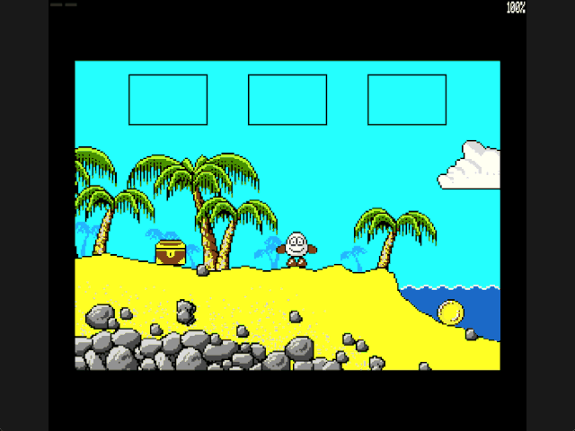

Welcome to the latest in my series of posts on Graphics with the SAM Coupé.

The earlier posts and source examples are available in the [series repository](https://github.com/pjgpetecodes/samcoupegraphics).

# Completing the Four-Screen Route

The [chest escape lesson](https://github.com/pjgpetecodes/samcoupegraphics/blob/main/assembly/blog20/blog-post.md) dropped the chest at the cliff, jumped onto it and leapt left over the wall into the sparse third screen. That screen's left edge has been a dead end until now.

This post adds just one concept: **linking the fourth room** in both directions, keeping the player at a matching height on each side. There are no new mechanics, hazards or moving actors yet.

Thank you to Adrian Brown for supplying the graphics and helping with this series. The [room provenance](https://github.com/pjgpetecodes/samcoupegraphics/blob/main/assembly/blog10/assets/provenance.json) identifies the permitted source graphics and collision masks. Original engine analysis remains private; this is independently written tutorial code.

## The Recovered Route

The four selected screens are not four consecutive leftward rooms:

| Tutorial screen | Scenery | Links in this post |
|---|---|---|
| 1 | Starting beach | Left to screen 2 |
| 2 | Cliff beach | Right to 1; up to 3 once the chest is placed |
| 3 | Sparse sky | Down to 2; **left to 4** |
| 4 | Grassy ground and tree | **Right to 3**; left is the bridge, outside this slice |

Screen 4's left boundary leads to the bridge, which is screen 5. It stays a solid boundary rather than an invented link.

## One Room Identifier, Four Rooms

`Build_Room` and `Load_Collision` now select explicitly between all four room descriptions from `Current_Room`. Scenery and solidity therefore can never disagree about which room is active.

All four compact collision streams were already generated and verified in the earlier room-composition work, so the whole slice still fits a 256 KB SAM.

## Height-Matched Horizontal Links

Both screen 3 and screen 4 have two very different elevations at their shared edge: clouds high up and ground low down. Spawning at a single fixed row would teleport Dizzy between them.

Instead, each link checks which half of the playfield Dizzy is in:

```text
screen 3 left  -> screen 4 at X=230, Y=62 if Y < 100, otherwise Y=152
screen 4 right -> screen 3 at X=0,   Y=63 if Y < 100, otherwise Y=155
```

Every entry row was checked against the real collision masks: the upper rows rest on the clouds and the lower rows rest on the grass and the tiny rock at screen 3's lower-left edge. These are explicit, safe tutorial entries rather than the original game's exact coordinate arithmetic.

As before, horizontal links are grounded-only. An airborne player touching the edge stays in the current room until landing.

## Persistent State Across the Whole Route

Nothing new is needed to keep the puzzle solved. `Chest_Placed` and the chest's dropped coordinates already live in resident memory. Falling out of the bottom of screen 3 still subtracts 100 rows, preserves downward speed and returns to the clear stance remembered when the chest was dropped, so Dizzy lands back on the same chest.

The second source coin now becomes reachable because its record already belonged to screen 4. The existing Enter pickup and LIFO inventory handle it without changes.

## Files in This Post

This post's folder starts as a complete copy of the [blog20 folder](https://github.com/pjgpetecodes/samcoupegraphics/tree/main/assembly/blog20), so it builds on its own without reaching into any other folder. The main file is [`23-1.asm`](https://github.com/pjgpetecodes/samcoupegraphics/blob/main/assembly/blog21/23-1.asm).

- **Changed:** [`collision.asm`](https://github.com/pjgpetecodes/samcoupegraphics/blob/main/assembly/blog21/collision.asm), [`rooms.asm`](https://github.com/pjgpetecodes/samcoupegraphics/blob/main/assembly/blog21/rooms.asm), [`variables.asm`](https://github.com/pjgpetecodes/samcoupegraphics/blob/main/assembly/blog21/variables.asm).
- Every other file is copied unchanged.

## Source, Disk and Result

Read the [line-by-line commented 23-1.asm](https://github.com/pjgpetecodes/samcoupegraphics/blob/main/assembly/blog21/23-1.asm), or download [the 23-1 disk](https://github.com/pjgpetecodes/samcoupegraphics/raw/refs/heads/main/disks/23-1.dsk).



The 256 KB SimCoupe recording shows the chest puzzle, the leftward escape onto screen 3's lower rock, a walk left into screen 4's grassy ground, a walk back right to screen 3, a fall down onto the still-placed chest in screen 2, then a walk back through to screen 1. The upper cloud links are present in the source but are not part of this recorded route.

Resident code/data end at `0xA150`, below the asserted resident limit and the `0xFF00` stack.

{{emulator:23-1}}

The web-emulator placeholder needs its disk uploaded to the site's separate disk-hosting location before publication.

```powershell
python .\.vscode\sam_build.py .\assembly\blog21\23-1.asm --build-only
python .\.vscode\capture_gifs.py 23-1
```

Z/X move, Space jumps on a fresh grounded press, and Enter collects or drops while stopped on the ground. Reset to stop.

Next we bring the scenery to life by animating the starting beach's waves.
