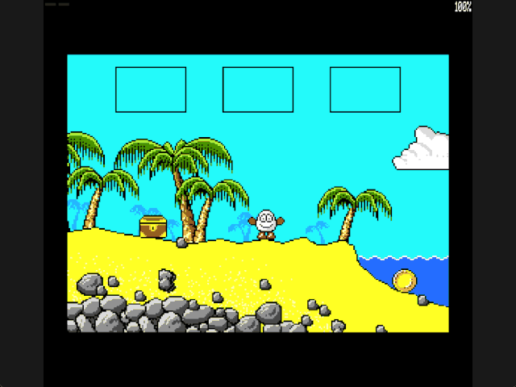

Welcome to the latest in my series of posts on Graphics with the SAM Coupé.

The earlier posts and source examples are available in the [series repository](https://github.com/pjgpetecodes/samcoupegraphics).

# Animating the Background

The [four-screen route](https://github.com/pjgpetecodes/samcoupegraphics/blob/main/assembly/blog21/blog-post.md) is complete, but its scenery is frozen. In Treasure Island Dizzy the sea on the starting beach is alive: little white crests roll along its surface.

This post adds just one concept: **animated background scenery**. The sea stays harmless for now. Hazards are the next lesson.

Thank you to Adrian Brown for supplying the graphics and helping with this series. The four wave frames were extracted with the same provenance tooling as the rest of the scenery; see [the wave provenance](https://github.com/pjgpetecodes/samcoupegraphics/blob/main/assembly/blog22/assets/provenance.json). This is independently written tutorial code.

## Four Small Frames

The sea's surface is not one big animated picture. It is a strip just 40 pixels wide and 4 rows high, drawn twice side by side at row 139. The game has four versions of the strip, source graphics 55 to 58, each with its crests shifted along slightly:

| Graphic | Size | Role |
|---|---|---|
| 55 | 20 bytes × 4 rows | Wave frame 0, and the one listed in the room's draw records |
| 56 | 20 bytes × 4 rows | Wave frame 1 |
| 57 | 20 bytes × 4 rows | Wave frame 2 |
| 58 | 20 bytes × 4 rows | Wave frame 3 |

Each frame is only 80 bytes of pixels, so all four sit in resident memory beside the code. That matters: the drawing routine maps the hidden screen into the lower 32 KB, so anything it reads at the same time must live above `0x8000`.

## Registering the Strips Instead of Baking Them

Until now `Build_Room` composed every draw record into the authoritative background in pages 6 and 7. If the wave strip were baked in there, every restore would bring back frame 0's crests, and drawing frame 2 on top would leave frame 0's white pixels showing through its transparent gaps.

The original game avoids this in a neat way, and we do the same. While the room is composed, any record that draws the first wave graphic is **registered** instead of drawn:

```text
for each room draw record:
    if its source is wave frame 0:
        remember the record's address in Water_Records
        skip it
    else:
        compose it into the background as before
```

The background therefore holds the scenery *underneath* the waves, and `Water_Records` holds the destination, width, height and stride of each strip. Room 1 registers two strips; the right-hand one is clipped to 10 bytes by the screen edge, and its unchanged 20-byte stride still steps correctly through the source rows. The other three rooms register none, so they cost nothing.

`Build_Room` clears `Water_Count` first, so changing rooms never redraws the previous room's water.

## Timing the Waves

The original advances its waves once per game frame, and a game frame there lasts three interrupts. Our main loop runs once per interrupt, so `Advance_Water` simply counts down from three:

```text
Water_Timer -= 1
if Water_Timer == 0:
    Water_Timer = 3
    Water_Frame = (Water_Frame + 1) AND 3
```

The `AND 3` wraps frame 3 back to frame 0 without a comparison. The timer is independent of Dizzy's own five-interrupt animation delay, just as background and sprite animation should be.

## Drawing on the Hidden Page

The waves are drawn as part of the same hidden-page frame as Dizzy, so a page flip always shows a complete picture. `Draw_Frame` now runs these steps on the hidden page:

1. `Clear_Sprite` restores the scenery under Dizzy's old position on this page.
2. `Restore_Water` copies the water-free scenery back over every registered strip, reusing `Restore_Background`.
3. `Draw_Sprite` draws Dizzy as before.
4. `Draw_Water` overlays the current wave frame with colour 0 transparent.

Because each strip is wiped clean in step 2, there is never any smearing between frames. And because the waves are drawn *after* Dizzy, the crests roll in front of him when he wades into the sea, exactly as you would expect from the surface of the water.

`Draw_Water` picks its source frame with a short loop, adding 82 bytes (the 2-byte header plus 80 pixel bytes) per frame index, then uses the same packed-nibble transparency test as the room compositor.

## Files in This Post

This post's folder starts as a complete copy of the [blog21 folder](https://github.com/pjgpetecodes/samcoupegraphics/tree/main/assembly/blog21), so it builds on its own without reaching into any other folder. The main file is [`24-1.asm`](https://github.com/pjgpetecodes/samcoupegraphics/blob/main/assembly/blog22/24-1.asm).

- **New:** [`water_animation.asm`](https://github.com/pjgpetecodes/samcoupegraphics/blob/main/assembly/blog22/water_animation.asm): the animated sea, registered from room records and redrawn every frame.
- **Changed:** [`constants.asm`](https://github.com/pjgpetecodes/samcoupegraphics/blob/main/assembly/blog22/constants.asm), [`dizzy_sprite.asm`](https://github.com/pjgpetecodes/samcoupegraphics/blob/main/assembly/blog22/dizzy_sprite.asm), [`rooms.asm`](https://github.com/pjgpetecodes/samcoupegraphics/blob/main/assembly/blog22/rooms.asm), [`variables.asm`](https://github.com/pjgpetecodes/samcoupegraphics/blob/main/assembly/blog22/variables.asm).
- **New assets:** `assets/image-55.bin`, `assets/image-56.bin`, `assets/image-57.bin`, `assets/image-58.bin`.
- Every other file is copied unchanged.

## Source, Disk and Result

Read the [line-by-line commented 24-1.asm](https://github.com/pjgpetecodes/samcoupegraphics/blob/main/assembly/blog22/24-1.asm), or download [the 24-1 disk](https://github.com/pjgpetecodes/samcoupegraphics/raw/refs/heads/main/disks/24-1.dsk).



The 256 KB SimCoupe recording shows the waves cycling through their four frames, then Dizzy walking down the beach into the water with the crests passing in front of him, and walking back out again.

Resident code/data end at `0xA3AF`, below the asserted resident limit and the `0xFF00` stack.

{{emulator:24-1}}

The web-emulator placeholder needs its disk uploaded to the site's separate disk-hosting location before publication.

```powershell
python .\.vscode\sam_build.py .\assembly\blog22\24-1.asm --build-only
python .\.vscode\capture_gifs.py 24-1
```

Z/X move, Space jumps on a fresh grounded press, and Enter collects or drops while stopped on the ground. Reset to stop.

Next we make that sea dangerous: detecting hazard contact separately from deciding what happens when the player dies.
