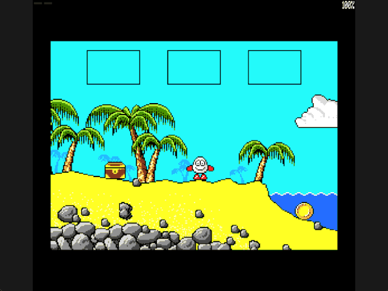

Welcome to the latest in my series of posts on Graphics with the SAM Coupé.

The earlier posts and source examples are available in the [series repository](https://github.com/pjgpetecodes/samcoupegraphics).

# Detecting Hazards

In the [last post](https://github.com/pjgpetecodes/samcoupegraphics/blob/main/assembly/blog22/blog-post.md) the starting beach's sea came to life. It still cannot hurt Dizzy: he can wade straight in and walk along the seabed.

This post adds one concept: **hazard detection**. We decide *when* Dizzy is touching something dangerous, and show that as a red border. What happens next, losing a life and restarting, is a separate decision and the subject of the next lesson. Keeping "did we touch it?" apart from "what does touching it do?" makes both easier to test.

Thank you to Adrian Brown for supplying the graphics and helping with this series. This is independently written tutorial code.

## Hazards Are Not Walls

Solid scenery lives in the collision mask: a pixel is either something Dizzy can stand on and bump into, or it is not. A hazard is different. Dizzy must be able to move *into* it, otherwise he could never touch it. So hazards do not go in the collision mask at all; they get their own small table of rectangles.

That also suits the beach. The collision mask already continues under the water as a seabed, which is why Dizzy can wade in. The sea itself only needs one rectangle on top.

## The Hazard Table

Each hazard is five bytes:

| Byte | Meaning |
|---|---|
| 0 | Room number, with 0 ending the table |
| 1 | Left edge in pixels (inclusive) |
| 2 | Right edge in pixels (inclusive) |
| 3 | Top row (inclusive) |
| 4 | Bottom row (inclusive) |

The table has one entry for now:

```text
room 1, X 200-255, Y 144-191
```

This rectangle is a **tutorial adaptation**, traced from the visible blue water on screen 1 rather than copied from the original game's own water handling. Starting a few pixels inside the shoreline means the very tip of Dizzy's foot on the wet sand does not count; he has to actually step into the sea.

## Testing for Overlap

`Check_Hazards` runs once per update, straight after gravity has settled Dizzy's position for that update. It uses exactly the same body box as solid collision, so "touching" means the same thing everywhere.

Two rectangles overlap unless one lies entirely to one side of the other. That gives four quick rejections:

```text
Hazard_Contact = 0
for each hazard record in this room:
    if body right  < hazard left:   next
    if body left   > hazard right:  next
    if body bottom < hazard top:    next
    if body top    > hazard bottom: next
    Hazard_Contact = 1
```

On the Z80 each test is a load, an `ADD` of the box offset, and a `CP` against the record through `IX`. `CP` sets carry when `A` is smaller, so "body right is less than hazard left" is simply `JR C`. The opposite test swaps the operands by loading the hazard edge into `A` and comparing it with the body edge held in another register, so the same `JR C` still means "no overlap".

The flag is recomputed from zero every update. Nothing has to remember to clear it when Dizzy walks back out.

## Showing the Result

`Show_Ground` already uses the border as a debug view: black when supported, yellow while airborne. Hazard contact now takes priority and turns it red (palette index 4). It is deliberately only a display; no other state changes yet.

## Files in This Post

This post's folder starts as a complete copy of the [blog22 folder](https://github.com/pjgpetecodes/samcoupegraphics/tree/main/assembly/blog22), so it builds on its own without reaching into any other folder. The main file is [`25-1.asm`](https://github.com/pjgpetecodes/samcoupegraphics/blob/main/assembly/blog23/25-1.asm).

- **New:** [`hazards.asm`](https://github.com/pjgpetecodes/samcoupegraphics/blob/main/assembly/blog23/hazards.asm): rectangles that are deadly to touch, tested against Dizzy's body box.
- **Changed:** [`walking.asm`](https://github.com/pjgpetecodes/samcoupegraphics/blob/main/assembly/blog23/walking.asm).
- Every other file is copied unchanged.

## Source, Disk and Result

Read the [line-by-line commented 25-1.asm](https://github.com/pjgpetecodes/samcoupegraphics/blob/main/assembly/blog23/25-1.asm), or download [the 25-1 disk](https://github.com/pjgpetecodes/samcoupegraphics/raw/refs/heads/main/disks/25-1.dsk).



The 256 KB SimCoupe recording shows Dizzy walking down the beach. As he steps off the sand there is a single yellow airborne frame while he drops onto the seabed, then the border turns red for as long as he is in the water. When he walks back up the beach it returns to black.

Resident code/data end at `0xA40E`, below the asserted resident limit and the `0xFF00` stack.

{{emulator:25-1}}

The web-emulator placeholder needs its disk uploaded to the site's separate disk-hosting location before publication.

```powershell
python .\.vscode\sam_build.py .\assembly\blog23\25-1.asm --build-only
python .\.vscode\capture_gifs.py 25-1
```

Z/X move, Space jumps on a fresh grounded press, and Enter collects or drops while stopped on the ground. Reset to stop.

Next we give the hazard its consequence: Dizzy loses his only life and the game restarts.
