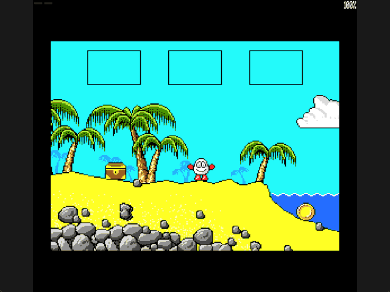

Welcome to the latest in my series of posts on Graphics with the SAM Coupé.

The earlier posts and source examples are available in the [series repository](https://github.com/pjgpetecodes/samcoupegraphics).

# Death and Restarting

In the [last post](https://github.com/pjgpetecodes/samcoupegraphics/blob/main/assembly/blog23/blog-post.md) we learned to detect when Dizzy touches the sea, but all that happened was a red border. This post adds one concept: **the consequence**. Touching a hazard now kills Dizzy, and the game restarts.

Thank you to Adrian Brown for supplying the graphics and helping with this series. This is independently written tutorial code.

## One Life

Treasure Island Dizzy is famous for being unforgiving: Dizzy has just one life. Touch the sea without the snorkel and the adventure is over.

We keep that rule, which makes the reset rules wonderfully simple: **everything goes back to the start**. The chest returns to the beach, both coins return to their places, the inventory empties, and the screen 2 escape is no longer solved. There is no "which items survive a death?" question to answer.

The original shows a game-over message and returns to its title screen. We have neither yet, so our version is simplified: a short death pause, then straight back to the starting beach.

## Taking a Snapshot at Boot

Rather than writing a routine that knows the starting value of every variable, we take a copy of the game's state the moment the program starts.

All of the state a restart must restore is already grouped together in memory: the current room, the chest-solved flag, the escape return position, the inventory, and the four world item records. Two labels now mark the start and end of that block:

```text
Game_State:      Current_Room, Chest_Placed, ..., Inventory_Slots, ...
                 World_Items (four 8-byte records)
Game_State_End:
Initial_State:   DEFS Game_State_End - Game_State
```

That is 47 bytes. The first thing `Start` does is copy them with a single `LDIR`:

```text
HL = Game_State, DE = Initial_State, BC = 47
LDIR
```

The assembler works out the length from the labels, so adding another piece of game state later only means placing it inside the block.

Anything outside the block, such as the display page, animation timers and the collision workspace, is either rebuilt when a room is entered or is harmless to keep.

## The Death Pause

A new `Death_Timer` byte is zero while Dizzy is alive. The main loop checks it after showing the last frame and advancing the waves:

```text
if Death_Timer != 0:
    jump to Dying
read jump, move, gravity
check hazards
if Hazard_Contact:
    Death_Timer = 100
    switch to the idle animation
```

Hazard detection itself is untouched from the last post; we only added what happens afterwards. While dying, the loop skips input, physics and collection entirely. Each interrupt `Dying`:

1. Counts `Death_Timer` down.
2. Flashes the border by testing bit 3 of the timer. That bit changes every eight interrupts, giving red for eight, black for eight.
3. Calls `Draw_Frame` without moving Dizzy, so the waves keep rolling over him on the hidden page.

The `LD` that stores the decremented timer does not change the flags, so the `JR Z` straight after it still tests the result of the `DEC`.

## Restarting

When the timer reaches zero, `Restart_Game` reverses the snapshot:

```text
HL = Initial_State, DE = Game_State, BC = 47
LDIR
Sprite_X = 120, facing right
Enter_Room(Initial_Row)
```

`Enter_Room` was written for room changes, and it already does everything a restart needs: rebuild the room's background including its items and the inventory boxes at the top of the screen, reload its collision, initialise both display pages, and reset the old-position records. Because the snapshot has put `Current_Room` back to 1 and emptied the inventory, it rebuilds the starting beach exactly as it first appeared.

## Files in This Post

This post's folder starts as a complete copy of the [blog23 folder](https://github.com/pjgpetecodes/samcoupegraphics/tree/main/assembly/blog23), so it builds on its own without reaching into any other folder. The main file is [`26-1.asm`](https://github.com/pjgpetecodes/samcoupegraphics/blob/main/assembly/blog24/26-1.asm).

- **New:** [`death_restart.asm`](https://github.com/pjgpetecodes/samcoupegraphics/blob/main/assembly/blog24/death_restart.asm): one life, a flashing death pause and a restart from the snapshot.
- **Changed:** [`constants.asm`](https://github.com/pjgpetecodes/samcoupegraphics/blob/main/assembly/blog24/constants.asm), [`variables.asm`](https://github.com/pjgpetecodes/samcoupegraphics/blob/main/assembly/blog24/variables.asm), [`walking.asm`](https://github.com/pjgpetecodes/samcoupegraphics/blob/main/assembly/blog24/walking.asm).
- Every other file is copied unchanged.

## Source, Disk and Result

Read the [line-by-line commented 26-1.asm](https://github.com/pjgpetecodes/samcoupegraphics/blob/main/assembly/blog24/26-1.asm), or download [the 26-1 disk](https://github.com/pjgpetecodes/samcoupegraphics/raw/refs/heads/main/disks/26-1.dsk).



The 256 KB SimCoupe recording shows Dizzy collecting the chest, which appears in the first inventory box, then walking down the beach into the sea. He freezes, the border flashes red for two seconds while the waves keep moving, and the game restarts: Dizzy is back at the start, the chest is back on the beach and the inventory is empty.

Resident code/data end at `0xA49E`, below the asserted resident limit and the `0xFF00` stack.

{{emulator:26-1}}

The web-emulator placeholder needs its disk uploaded to the site's separate disk-hosting location before publication.

```powershell
python .\.vscode\sam_build.py .\assembly\blog24\26-1.asm --build-only
python .\.vscode\capture_gifs.py 26-1
```

Z/X move, Space jumps on a fresh grounded press, and Enter collects or drops while stopped on the ground. Reset to stop.

Next we add something that moves on its own: an enemy patrolling the fourth screen.
