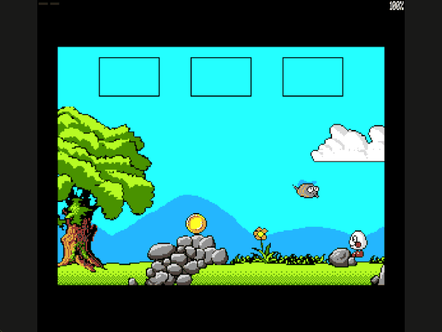

Welcome to the latest in my series of posts on Graphics with the SAM Coupé.

The earlier posts and source examples are available in the [series repository](https://github.com/pjgpetecodes/samcoupegraphics).

# A Moving Actor

So far Dizzy has been the only thing on screen that moves by itself. In Treasure Island Dizzy the grassy fourth screen has a bee buzzing back and forth above the ground. This post adds one concept: **a moving actor**, something with its own position, movement rule and animation that has nothing to do with the keyboard.

The bee only moves for now. Touching it is the subject of the next post.

Thank you to Adrian Brown for supplying the graphics and helping with this series. The four bee frames were extracted with the same provenance tooling as the rest of the graphics; see [the bee provenance](https://github.com/pjgpetecodes/samcoupegraphics/blob/main/assembly/blog25/assets/provenance.json). This is independently written tutorial code.

## The Bee's Frames

The bee is four source graphics, each 11 bytes (22 pixels) wide and 22 rows tall:

| Graphic | Frame index | Facing | Wings |
|---|---|---|---|
| 327 | 0 | Right | Up |
| 328 | 1 | Right | Down |
| 329 | 2 | Left | Up |
| 330 | 3 | Left | Down |

Colour 0 is transparent, just like the waves and the room scenery. The colours come from the game's own fixed palette, which we have loaded unchanged since the backgrounds post. All four frames are 976 bytes in total, so they sit in resident memory beside the code where they can be read while a screen is mapped into the lower 32 KB.

## Where the Numbers Come From

The original game keeps a table of actors, each with a room, position, velocity and a pair of bounds. The bee's entry gives us everything we need:

| Property | Value |
|---|---|
| Room | The fourth screen |
| Start | Byte X 77 (pixel 154), row 100 |
| Movement | Horizontal, +1 byte per game frame |
| Patrol bounds | Byte X 55 to 115 |

Like the waves, the original moves its actors once per game frame, which is three interrupts. So the bee covers two pixels every three interrupts, a gentle drift of about 33 pixels a second.

Its X is measured in **bytes**, not pixels. That is a lovely simplification: in MODE 4 each byte holds two pixels, so a byte-aligned sprite never needs the shifted copy that Dizzy needs on odd pixel positions. The bee always occupies exactly 11 bytes on each row.

## Moving and Turning

`Advance_Bee` is called once per update, straight after `Advance_Water`, and does nothing unless the fourth screen is displayed. It counts its own three-interrupt timer, then:

```text
Bee_Flap = Bee_Flap XOR 1
Bee_X = Bee_X + Bee_Velocity
if Bee_X < 55 or Bee_X > 115:
    Bee_Velocity = -Bee_Velocity
Bee_Frame = (Bee_Velocity AND 2) OR Bee_Flap
```

The bee steps one byte past a bound and then turns, so its real range is byte 54 to 116. Even at 116 its right-hand edge is byte 126, still inside the 128-byte row.

`NEG` reverses the velocity in a single instruction: +1 becomes 255 (-1) and back again.

The last line picks the frame without a single comparison. Flying right the velocity is `00000001`; flying left it is `11111111`. Bit 1 is clear in the first and set in the second, so `AND 2` gives 0 or 2: exactly the offset of the right- or left-facing pair. `OR` adds the wing position to choose between the pair's two frames.

`Advance_Bee` runs before the main loop checks for a death in progress, so the bee keeps flying while Dizzy is dying, just as the waves keep rolling.

## Two Sprites on the Hidden Page

Drawing another moving sprite reuses everything we already have for Dizzy. Because we double-buffer, each display page remembers where it last drew the bee: `Bee_Old_10` and `Bee_Old_14`, just like `Previous_X_10` and `Previous_X_14` for Dizzy. The value 255 means "no bee on this page". `Enter_Room` sets both to 255, because it has just painted fresh scenery onto both pages.

`Draw_Frame` now runs these steps on the hidden page:

1. `Clear_Sprite` restores the scenery under Dizzy's old position.
2. `Restore_Water` restores the wave strips.
3. `Restore_Bee` restores the 11 × 22 rectangle where this page last drew the bee, using the same `Restore_Background` copier.
4. `Draw_Bee` draws the current bee frame with colour 0 transparent and records its X for this page.
5. Dizzy is drawn, then the waves on top.

The order matters. Every old rectangle is restored *before* anything new is drawn, so restoring Dizzy's old position can never wipe out part of a freshly drawn bee. The bee is drawn before Dizzy, so if they overlap, Dizzy is in front.

## Files in This Post

This post's folder starts as a complete copy of the [blog24 folder](https://github.com/pjgpetecodes/samcoupegraphics/tree/main/assembly/blog24), so it builds on its own without reaching into any other folder. The main file is [`27-1.asm`](https://github.com/pjgpetecodes/samcoupegraphics/blob/main/assembly/blog25/27-1.asm).

- **New:** [`bee_actor.asm`](https://github.com/pjgpetecodes/samcoupegraphics/blob/main/assembly/blog25/bee_actor.asm): the bee that patrols the fourth screen.
- **Changed:** [`constants.asm`](https://github.com/pjgpetecodes/samcoupegraphics/blob/main/assembly/blog25/constants.asm), [`dizzy_sprite.asm`](https://github.com/pjgpetecodes/samcoupegraphics/blob/main/assembly/blog25/dizzy_sprite.asm), [`rooms.asm`](https://github.com/pjgpetecodes/samcoupegraphics/blob/main/assembly/blog25/rooms.asm).
- **New assets:** `assets/image-327.bin`, `assets/image-328.bin`, `assets/image-329.bin`, `assets/image-330.bin`.
- Every other file is copied unchanged.

## Source, Disk and Result

Read the [line-by-line commented 27-1.asm](https://github.com/pjgpetecodes/samcoupegraphics/blob/main/assembly/blog25/27-1.asm), or download [the 27-1 disk](https://github.com/pjgpetecodes/samcoupegraphics/raw/refs/heads/main/disks/27-1.dsk).



The 256 KB SimCoupe recording starts once Dizzy has completed the route from the starting beach (collect the chest, drop it at the screen 2 wall, jump from it over the wall, then walk left from screen 3). The bee flies right, turns at the end of its patrol to face left, and flies back, flapping all the way, while Dizzy walks in underneath. There are no trails left behind on either display page.

Resident code/data end at `0xA94E`, below the asserted resident limit and the `0xFF00` stack.

{{emulator:27-1}}

The web-emulator placeholder needs its disk uploaded to the site's separate disk-hosting location before publication.

```powershell
python .\.vscode\sam_build.py .\assembly\blog25\27-1.asm --build-only
python .\.vscode\capture_gifs.py 27-1
```

Z/X move, Space jumps on a fresh grounded press, and Enter collects or drops while stopped on the ground. Reset to stop.

Next we make the bee dangerous. Because each feature has its own file, that post only needs to change `bee_actor.asm` and `hazards.asm`.
