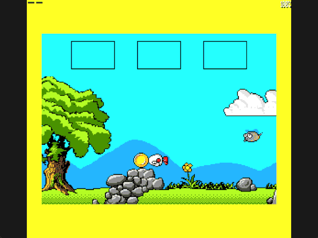

Welcome to the latest in my series of posts on Graphics with the SAM Coupé.

The earlier posts and source examples are available in the [series repository](https://github.com/pjgpetecodes/samcoupegraphics).

# Enemy Contact

In the last post a bee started patrolling the grassy fourth screen, but it was harmless: Dizzy could fly straight through it. This post adds one concept: **enemy contact**. Touching the bee now costs Dizzy his only life, using the death and restart sequence we already have.

This is where splitting the program into files back in Blog 11 really pays off. Only two of the feature files change.

Thank you to Adrian Brown for supplying the graphics and helping with this series. This is independently written tutorial code. In our version touching the bee is fatal; treat that as a rule of this tutorial rather than an exact description of the original game.

## Only Two Files Change

`28-1.asm` is the same short main file as last time, and the folder is a complete copy of Blog 25's. Only two files change:

| File | Change |
|---|---|
| `hazards.asm` | One new five-byte record in the hazard table |
| `bee_actor.asm` | Five body-box constants and six lines in `Advance_Bee` |

Everything else, from walking to the inventory, is exactly the code you have already read.

## Files in This Post

This post's folder starts as a complete copy of the [blog25 folder](https://github.com/pjgpetecodes/samcoupegraphics/tree/main/assembly/blog25), so it builds on its own without reaching into any other folder. The main file is [`28-1.asm`](https://github.com/pjgpetecodes/samcoupegraphics/blob/main/assembly/blog26/28-1.asm).

- **Changed:** [`bee_actor.asm`](https://github.com/pjgpetecodes/samcoupegraphics/blob/main/assembly/blog26/bee_actor.asm), [`hazards.asm`](https://github.com/pjgpetecodes/samcoupegraphics/blob/main/assembly/blog26/hazards.asm).
- Every other file is copied unchanged.

## An Enemy Is a Moving Hazard

We already have everything needed to kill Dizzy. The hazards post gave us `Check_Hazards`, which walks a table of rectangles and compares each one in the current room with Dizzy's body box. The death post made any contact start the flashing pause and the restart.

So we don't need a separate enemy test at all. An enemy is simply a hazard whose rectangle moves. We add a record for the bee's body to the end of the hazard table and give it a label so the bee can find it:

```text
Hazard_Table:   DEFB 1,200,255,144,191        ; Starting beach sea
Bee_Hazard:     DEFB Bee_Room                 ; Room 4
                DEFB left, right              ; Rewritten as the bee moves
                DEFB Bee_Y+9, Bee_Y+21        ; Body top and bottom rows
                DEFB 0                        ; End of table
```

The room byte means the record is ignored everywhere except the fourth screen, exactly like the sea is ignored outside the beach.

## Which Part of the Bee Hurts?

The bee's frames are 22 × 22 pixels, but a lot of that is wings and empty space. If the whole frame were deadly, Dizzy would die when he was still visibly clear of the bee, which feels unfair. We measured the opaque pixels of all four frames and chose a smaller **body box**:

| Edge | Offset in the frame | Why |
|---|---|---|
| Left | 2 | Leaves out the tip of the stinger |
| Right | 18 | Leaves out the tip of the antenna |
| Top | 9 | Leaves out the flapping wings |
| Bottom | 21 | The body reaches the last row |

This is the same idea as Dizzy's own box, which already ignores the transparent margin round his sprite.

## Keeping the Record in Step

The bee only moves horizontally, so the top and bottom rows never change. Every time `Advance_Bee` moves the bee, it rewrites just the left and right edges:

```text
pixel_x = Bee_X * 2
Bee_Hazard.left  = pixel_x + 2
Bee_Hazard.right = pixel_x + 18
```

The bee's X is measured in bytes, two pixels each, so `ADD A,A` doubles it into pixels. The largest X the bee ever reaches is byte 116, and `116 × 2 + 18 = 250` still fits in a single byte, so the whole sum works in the accumulator with no 16-bit arithmetic. The starting values in the table use the same sums at assembly time, so the record is right even before the bee's first move.

Because `Advance_Bee` runs before `Check_Hazards` in each update, the test always uses the bee's current position.

## Reaching the Bee

On the lower grass Dizzy can't reach the bee: its body rows are 109 to 121, and a jump from the ground only lifts Dizzy's body to about row 128. The pile of rocks near the tree is the way up. Its top is around row 151, 23 pixels above the grass, so from there a jump carries him into the bee's flight path whenever it patrols over the rocks.

In our version that makes the rocks the dangerous spot on this screen: jump there only while the bee is away at the other end of its patrol.

## What Happens After Contact

Nothing new. `Check_Hazards` sets `Hazard_Contact`, the main loop calls `Start_Death`, and Dizzy freezes where he touched the bee. The border flashes red for two seconds while the bee and the waves carry on, then `Restart_Game` copies the snapshot back and puts Dizzy on the starting beach with the chest restored.

The bee's position isn't part of the restart snapshot. It keeps patrolling from wherever it was, and its hazard record keeps following it, so the two can never get out of step.

## Source, Disk and Result

Start with the [line-by-line commented 28-1.asm](https://github.com/pjgpetecodes/samcoupegraphics/blob/main/assembly/blog26/28-1.asm), then read the two changed files, [hazards.asm](https://github.com/pjgpetecodes/samcoupegraphics/blob/main/assembly/blog26/hazards.asm) and [bee_actor.asm](https://github.com/pjgpetecodes/samcoupegraphics/blob/main/assembly/blog26/bee_actor.asm). You can also download [the 28-1 disk](https://github.com/pjgpetecodes/samcoupegraphics/raw/refs/heads/main/disks/28-1.dsk).



The 256 KB SimCoupe recording starts once Dizzy has completed the route to screen 4, jumped the boulder and climbed onto the rocks. He jumps on the spot as the bee comes back towards him. The jump that meets its body turns the border red, Dizzy freezes while the bee flies on, and two seconds later he is back on the starting beach with the chest in its original place.

Resident code/data end at `0xA961`, 19 bytes more than last time for the new hazard record and the six new instructions.

{{emulator:28-1}}

The web-emulator placeholder needs its disk uploaded to the site's separate disk-hosting location before publication.

```powershell
python .\.vscode\sam_build.py .\assembly\blog26\28-1.asm --build-only
python .\.vscode\capture_gifs.py 28-1
```

Z/X move, Space jumps on a fresh grounded press, and Enter collects or drops while stopped on the ground. Reset to stop.

That completes the engine for our four screens. The final post puts it all together and walks through the whole route.
