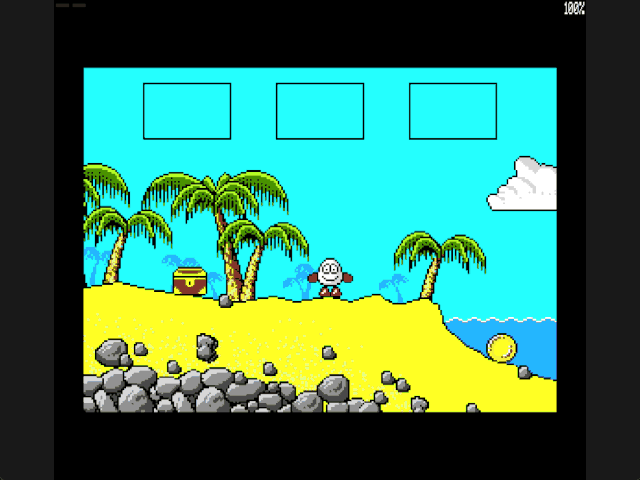

Welcome to the latest in my series of posts on Graphics with the SAM Coupé.

The earlier posts and source examples are available in the [series repository](https://github.com/pjgpetecodes/samcoupegraphics).

# The Complete Four-Screen Route

This post introduces no new concepts. Since we first drew a background, seventeen posts have built a small Dizzy engine one idea at a time, and every piece is now in place. Here we take the finished files and play the whole route from the starting beach to the bee's meadow.

Thank you to Adrian Brown for supplying the graphics and helping with this series. This is independently written tutorial code: the scenery and sprites come from Treasure Island Dizzy, but the engine and its rules are our own.

## Assembling the Finished Game

`29-1.asm` is the same short main file as the last post, and this folder is a complete copy of the enemy-contact post's folder. Nothing in any feature file changes. Assembling `29-1.asm` gives exactly the same symbol map as `28-1.asm`, which is a quick way to prove that the final program is the code you've already read.

## Files in This Post

This post's folder starts as a complete copy of the [blog26 folder](https://github.com/pjgpetecodes/samcoupegraphics/tree/main/assembly/blog26), so it builds on its own without reaching into any other folder. The main file is [`29-1.asm`](https://github.com/pjgpetecodes/samcoupegraphics/blob/main/assembly/blog27/29-1.asm).

- **Nothing changes.** Every file is an identical copy; only the main file's header comment is new.

## Where Each Piece Came From

Each file belongs to a post that introduced its idea. If something in the finished game puzzles you, this table shows where to look:

| File | What it does | Introduced in |
|---|---|---|
| `constants.asm` | Ports, pages and tuning values | Memory paging (blog 7) onwards |
| `screen_paging.asm` | Paging, screen copies and page flips | Memory paging and static backgrounds (blogs 7 and 10) |
| `dizzy_sprite.asm` | Masked, animated drawing at any pixel | Transparency, animation and pixel positioning (blogs 3, 4 and 9) |
| `rooms.asm` | Room composition and exits | Room composition and connecting rooms (blogs 12 and 17) |
| `collision.asm` | Solidity mask and box tests | Horizontal collision (blog 13) |
| `walking.asm` | Walking and ground following | Ground contact and walking (blog 14) |
| `jump_gravity.asm` | Falling, landing and jumping | Gravity and jumping (blogs 15 and 16) |
| `items_inventory.asm` | Collecting, dropping and the inventory | The chest, the inventory and the escape (blogs 18 to 20) |
| `water_animation.asm` | The animated sea | Animated background scenery (blog 22) |
| `hazards.asm` | Deadly rectangles | Hazards and enemy contact (blogs 23 and 26) |
| `death_restart.asm` | The death pause and restart | Death and restarting (blog 24) |
| `bee_actor.asm` | The patrolling bee | A moving actor and enemy contact (blogs 25 and 26) |
| `variables.asm` | Shared state and the restart snapshot | Grows with every post |
| `paged_data.asm` | Sprites, scenery and collision data in upper pages | Banked data and the four-screen route (blogs 7 and 21) |

## Walking the Route

The recording below plays the whole route without cuts. Here's what happens, and which ideas each step relies on.

1. **The starting beach.** Dizzy walks left to the chest and presses Enter. The chest disappears from the sand and appears in the first inventory box. Walking follows the slope of the sand, and the sea to the right is a hazard.
2. **The rock wall.** Walking left takes him through the room exit to the second screen, where a rock wall is too high to jump. Horizontal collision stops him at the rock face.
3. **Using the chest.** He drops the chest where he stands, right beside the wall. Placed there, it becomes a step he can stand on. He jumps onto it, and the inventory is empty again.
4. **Over the top.** From the chest, a jump to the left carries him up over the wall into the third screen, and gravity brings him down onto solid ground.
5. **The meadow.** Walking on reaches the fourth screen and the bee. Dizzy jumps the boulder, walks to the rock pile and jumps onto it, timing the jump so the bee is away at the far end of its patrol.
6. **The coin.** Standing on the rocks, he presses Enter and the coin moves into the inventory, while the bee flies past overhead.

The coin is collected with exactly the same code that picked up the chest on the first screen. The data-driven item table means the fourth room needed no special code at all.

## Source, Disk and Result

Read the [line-by-line commented 29-1.asm](https://github.com/pjgpetecodes/samcoupegraphics/blob/main/assembly/blog27/29-1.asm), and follow its `INCLUDE` lines into the [other files in the blog27 folder](https://github.com/pjgpetecodes/samcoupegraphics/tree/main/assembly/blog27). You can also download [the 29-1 disk](https://github.com/pjgpetecodes/samcoupegraphics/raw/refs/heads/main/disks/29-1.dsk).



The 256 KB SimCoupe recording runs from power-on to the coin. The chest moves into the inventory on the beach and out again beside the wall on the second screen. The border turns yellow while Dizzy is in the air. The run ends with the coin in the first inventory box and Dizzy standing safely on the rocks as the bee flies by.

Resident code/data end at `0xA961`, the same as the previous post, because the program is identical.

{{emulator:29-1}}

The web-emulator placeholder needs its disk uploaded to the site's separate disk-hosting location before publication.

```powershell
python .\.vscode\sam_build.py .\assembly\blog27\29-1.asm --build-only
python .\.vscode\capture_gifs.py 29-1
```

Z/X move, Space jumps on a fresh grounded press, and Enter collects or drops while stopped on the ground. Reset to stop.

## Looking Back

We started this series by copying a square onto the screen. Since then we've added transparency, animation, keyboard input, palettes and memory paging. Then came scenery, collision, gravity, jumping, items, an inventory, animated water, hazards, death, and a moving enemy, all kept in one tidy file per feature.

The engine is deliberately small, so there is plenty of room to take it further. You could add more screens from the original game, more items and puzzles, lives, a score, or sound. Every one of those is a single new idea, which you can add one at a time just as we have throughout the series.
