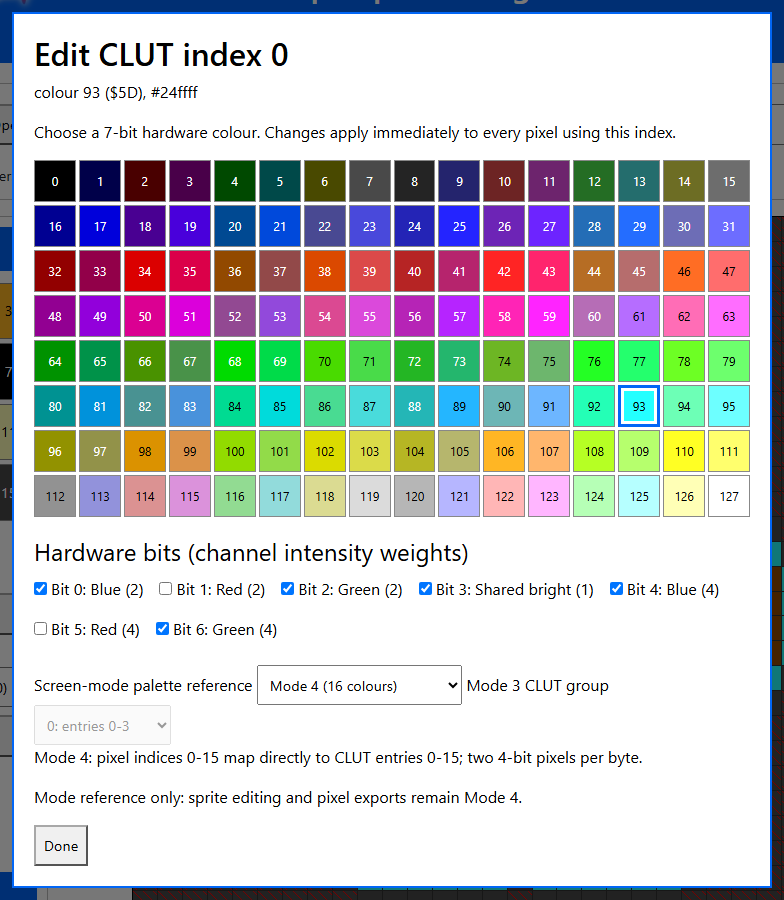
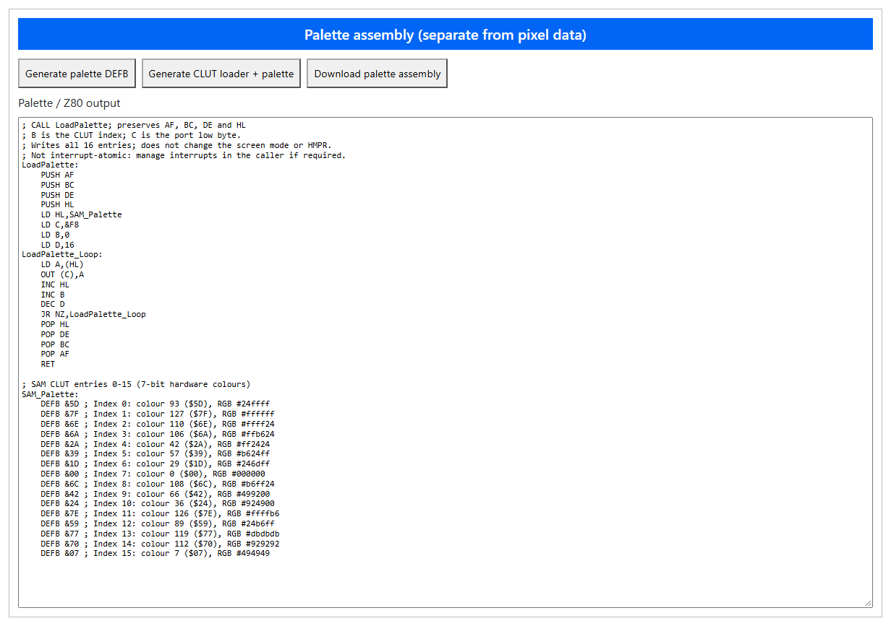

Welcome to the latest in my series of posts on Graphics with the SAM Coupé.

You can find the other posts in this series here;

- Sam Coupe Assembly Language Programming
- Graphics in Assembly for the SAM Coupé
- Making SAM Coupé Sprites Transparent
- Animating SAM Coupé Sprites
- Controlling SAM Coupé Sprites with the Keyboard
- The GitHub Repo

You can find all the files for the series in my GitHub Repo here;

https://github.com/pjgpetecodes/samcoupegraphics

# Colour Palettes on the SAM Coupé

So far Dizzy has been drawn in whatever colours the SAM gives us when it starts up. In this tutorial we take control of the palette with the palette tools in my SAM Coupé Sprite Editor, then use it in the animation we've already built. We'll do it in three steps;

1. Design a 16-colour palette in the editor, save it, and export the CLUT loader and palette.
2. Change a palette entry while the program runs, and watch the whole background change.
3. Hold Z or X and press Space to jump sideways, using more frames of Dizzy.

We continue directly from the end of our [previous post on Keyboard Input](https://www.petecodes.co.uk/graphics-with-the-sam-coupe-keyboard-input/) and from the GitHub repo file `assembly/blog5/7-3.asm`.

## What is a Palette?

In MODE 4 every pixel is four bits, which gives us the numbers 0 to 15. That number doesn't say what colour the pixel is, though. It is an index into the Colour Look Up Table, or CLUT. The CLUT holds 16 entries, and each entry is a 7-bit value which picks one of the SAM's 128 hardware colours.

The 16 swatches in the Sprite Editor are these CLUT indices, not the 128 hardware colours themselves. Sprites store the indices. If we edit a palette entry, every pixel in every sprite or animation frame using that index changes colour at once; the sprite pixels and transparency do not need to change.

The CLUT is written through port `248` (`0xF8`). The palette entry number selects which index to change, and the 7-bit hardware colour is the value written to it. The editor can generate the loader and table for us, so we don't have to hand-code the `OUT` loop.

## Step 1: Our Own Palette

### The Dizzy Sprites

In the previous tutorial we used frames remapped to the system palette. This time we use the original colour indices from a Dizzy sprite sheet supplied by Adrian Brown (Thanks!).

The data is in `assembly/blog6/tidizzy_interleaved.asm`, and it's the first 24 sprites. They are the same frames in the same order as before, so the animation tables only need new label names;

```z80
Idle_Animation: DEFB    2
                DEFW    TIDizzy_1_Interleaved,TIDizzy_2_Interleaved
;
Jump_Animation: DEFB    8
                DEFW    TIDizzy_1_Interleaved,TIDizzy_3_Interleaved
                DEFW    TIDizzy_4_Interleaved,TIDizzy_5_Interleaved
                DEFW    TIDizzy_6_Interleaved,TIDizzy_7_Interleaved
                DEFW    TIDizzy_8_Interleaved,TIDizzy_9_Interleaved
```

The full sprite sheet has 62 sprites, which is 62K of data. That's too much to keep in memory next to our program, so we only include the first 24 for now.

### Designing the Palette

Open the palette tools in the Sprite Editor and choose a hardware colour for each of the 16 CLUT indices. The selected colour can be edited with the 128-colour SAM master picker or with its 7-bit channel checkboxes; the editor shows the values in decimal and hexadecimal. The presets include the Default SAM palette (ROM 3.0) and the ROM Mode 3 defaults (group 0 maps logical colours 0, 17, 34, 127 to physical entries 0, 2, 1, 3). The Mode 3 reference is informational only: this editor does not export attribute or 2-bit sprite formats.



Save the palette JSON as a separate file if you want to reuse just the palette, and open it again independently of a sprite project. The project JSON and autosave also include the palette. Older projects which don't have palette data use the default palette when opened. The Set transparent checkbox paints transparency regardless of which colour is selected.

There are a couple of important import details. Importing raw assembly assumes the default palette, so open your custom palette afterwards. PNG import quantizes to the current palette, with the first palette index winning a tie. Sprite, mask, and interleaved exports contain colour indices only; the palette has to be loaded separately.

### Exporting the CLUT Loader and Palette

The Export panel can generate just the palette `DEFB` table with comments, or the CLUT loader and palette together. Here we're using the latter. The Download palette assembly option follows the selected hexadecimal notation. The loader preserves `AF`, `BC`, `DE`, and `HL`. It doesn't change the video mode or HMPR group.



This is the output from the editor for the palette used in this example:

```z80
; CALL LoadPalette; preserves AF, BC, DE and HL
; B is the CLUT index; C is the port low byte.
; Writes all 16 entries; does not change the screen mode or HMPR.
; Not interrupt-atomic: manage interrupts in the caller if required.
LoadPalette:
    PUSH AF
    PUSH BC
    PUSH DE
    PUSH HL
    LD HL,SAM_Palette
    LD C,&F8
    LD B,0
    LD D,16
LoadPalette_Loop:
    LD A,(HL)
    OUT (C),A
    INC HL
    INC B
    DEC D
    JR NZ,LoadPalette_Loop
    POP HL
    POP DE
    POP BC
    POP AF
    RET

; SAM CLUT entries 0-15 (7-bit hardware colours)
SAM_Palette:
    DEFB &5D ; Index 0: colour 93 ($5D), RGB #24ffff
    DEFB &7F ; Index 1: colour 127 ($7F), RGB #ffffff
    DEFB &6E ; Index 2: colour 110 ($6E), RGB #ffff24
    DEFB &6A ; Index 3: colour 106 ($6A), RGB #ffb624
    DEFB &2A ; Index 4: colour 42 ($2A), RGB #ff2424
    DEFB &39 ; Index 5: colour 57 ($39), RGB #b624ff
    DEFB &1D ; Index 6: colour 29 ($1D), RGB #246dff
    DEFB &00 ; Index 7: colour 0 ($00), RGB #000000
    DEFB &6C ; Index 8: colour 108 ($6C), RGB #b6ff24
    DEFB &42 ; Index 9: colour 66 ($42), RGB #499200
    DEFB &24 ; Index 10: colour 36 ($24), RGB #924900
    DEFB &7E ; Index 11: colour 126 ($7E), RGB #ffffb6
    DEFB &59 ; Index 12: colour 89 ($59), RGB #24b6ff
    DEFB &77 ; Index 13: colour 119 ($77), RGB #dbdbdb
    DEFB &70 ; Index 14: colour 112 ($70), RGB #929292
    DEFB &07 ; Index 15: colour 7 ($07), RGB #494949
```

The sprite bytes still hold indices, not these hardware colour values. Include the exported palette code in the program and call `LoadPalette` before the first sprite is drawn:

```z80
                CALL    LoadPalette    ; Apply the editor palette before drawing
                LD      HL,Idle_Animation
                CALL    Set_Animation  ; Draw the first sprite frame
```

### The ROM Resets the Palette

Calling the loader once at startup isn't enough. Our main loop uses `HALT` to wait for the 50 Hz interrupt, and the ROM interrupt routine restores its own palette. So we load our palette again after every `HALT`, before drawing the next frame.

The generated routine isn't interrupt-atomic. This example briefly disables interrupts around the loader so an interrupt can't leave only part of the CLUT updated. The routine restores the registers it uses; the caller controls interrupts.

```z80
Animation_Loop: HALT                    ; Wait for the next 50 Hz interrupt
                DI                      ; Keep the 16 CLUT writes together
                CALL    LoadPalette    ; The ROM interrupt reset the palette
                EI                      ; Re-enable interrupts after the complete palette is loaded
                CALL    Show_Pending_Frame ; Swap pages if a new frame is ready
                CALL    Choose_Animation ; Idle, walk or jump, depending on the keyboard
                CALL    Update_Animation ; Change frame when the delay expires
                JR      Animation_Loop  ; Repeat forever
```

The palette data is a separate include from the sprite data. Keep the generated routine and table together in `sam_palette.asm`; the sprite include supplies only the indexed sprite pixels. The raw assembly importer assumes the default palette, so load the custom palette separately when opening those sprite files in the editor.

### The Full Assembly

Full Assembly Listing for 8-1.asm

https://github.com/pjgpetecodes/samcoupegraphics/blob/main/assembly/blog6/8-1.asm

### Download the Disk Image

You can download the disk image for 8-1.asm to run in SimCoupe or on your real SAM [here](https://github.com/pjgpetecodes/samcoupegraphics/raw/refs/heads/main/disks/8-1.dsk);

### The Result


Dizzy is now drawn with the hardware colours selected for the sprite's indices. Index 0 is cyan in this palette, so the cleared background is cyan too. Everything else works just as before, with Space to roll, and Z and X to walk.

### See the result in the SAM Coupe Web Emulator

{{emulator:8-1}}

## Step 2: Changing the Palette on the Fly

Now for the fun part. The whole background is colour 0, because that is what we clear the screen to. So if we change palette entry 0, the whole background changes colour without us drawing anything.

We'll let keys 1 to 5 choose the background. The editor supplies the palette values used for the sprite; this small extra table is program-specific and gives the keys their runtime choices. Choose the five hardware colours in the editor's master picker and put their 7-bit values here. The editor exports the static palette and loader, not this keyboard-selection logic;

```z80
Background_Colours:
                DEFB    &00, &11, &22, &44, &7F
```

These example values are black, blue, red, green and white. The number keys are on the keyboard row `0xF7FE`, and bit 0 is key 1, through to bit 4 which is key 5. A key which is down reads as zero.

We shift each bit out in turn with `RRA` into the carry flag, and when we find a key that is down, we use its colour. Otherwise we move on to the next entry in the table;

```z80
Choose_Background:
                LD      BC,0xF7FE       ; Keyboard row 1 2 3 4 5 (port 0xFE)
                IN      A,(C)           ; A bit is 0 when its key is down
                LD      HL,Background_Colours
                LD      B,5             ; Check the five keys
;
Background_Key: RRA                     ; Move the next key bit into the carry flag
                JR      NC,Set_Background ; Carry clear means this key is down
                INC     HL              ; Try the next colour
                DJNZ    Background_Key  ; Continue until all five keys are checked
                RET                     ; No key was down
```

We don't write to the CLUT here. The ROM resets it every frame, so instead we replace the first entry of the generated `SAM_Palette` table. The next call to `LoadPalette` writes the updated value;

```z80
Set_Background: LD      A,(HL)          ; Read the chosen colour value
                LD      (SAM_Palette),A ; Replace entry 0 in the generated palette table
                RET                     ; LoadPalette writes it to the CLUT next frame
```

Then we call it from the main loop;

```z80
                CALL    Choose_Background ; Keys 1 to 5 pick the background colour
                CALL    Choose_Animation ; Idle, walk or jump, depending on the keyboard
```

Notice that Dizzy never flickers when the background changes. We didn't redraw a single pixel, we just told the hardware that colour 0 now means something else.

Dizzy's own black outline is a different palette entry, so it stays black whichever background we pick.

### The Full Assembly

Full Assembly Listing for 8-2.asm

https://github.com/pjgpetecodes/samcoupegraphics/blob/main/assembly/blog6/8-2.asm

### Download the Disk Image

You can download the disk image for 8-2.asm to run in SimCoupe or on your real SAM [here](https://github.com/pjgpetecodes/samcoupegraphics/raw/refs/heads/main/disks/8-2.dsk);

### The Result


Press keys 1 to 5 and the background changes colour instantly.

### See the result in the SAM Coupe Web Emulator

{{emulator:8-2}}

## Step 3: Sideways Jumps

The sprite sheet has more of Dizzy than we've used so far. Frames 26 to 32 are Dizzy jumping to the left, and frames 33 to 39 are Dizzy jumping to the right. We want Space on its own to still roll, but if we're holding Z or X when we press Space, Dizzy should jump in that direction instead.

### Running Out of Memory

There's a problem though. We'd now need 38 frames at 1K each, and our program lives in the top 32K of memory. The bottom half is no use to us, because the screen is paged in there while we draw.

Each frame is 32 by 32 pixels, but Dizzy only fills a small part of it. If we look through all of the frames, he never uses anything outside of screen bytes 1 to 13, or rows 5 to 26. So we crop every frame to a 13 byte by 22 row box. Each frame shrinks from 1024 bytes to 572, and all 38 frames come to around 22K, which fits.

The cropped data is in `assembly/blog6/tidizzy_cropped.asm`, and it replaces the previous data file. We add three constants to describe the box, and use them in `Clear_Sprite` and `Draw_Sprite` instead of the old 32 rows and 16 bytes;

```z80
Sprite_Bytes:   EQU     13              ; Screen bytes per cropped row
Sprite_Rows:    EQU     22              ; Rows in a cropped frame
Sprite_Start:   EQU     5*128+1         ; Row 5, byte 1 of the screen, where the crop began
```

```z80
Draw_Sprite:    LD      C,Sprite_Rows    ; Process every sprite row
;
Sprite_Row:     PUSH    BC              ; Preserve row count while B counts bytes
                LD      B,Sprite_Bytes   ; Process the sprite bytes in this row
```

The skip to the next screen row is now `128-Sprite_Bytes`, and we start drawing at `Sprite_Start` rather than the very top left, so Dizzy stays exactly where he was. As a bonus, we now draw and clear a lot less each frame.

### Sequences That Play Once

Until now the roll was special. `Choose_Animation` and `Update_Animation` both compared the current sequence against `Jump_Animation` to find out if it was the one that plays once. With three sequences like that, we'd be comparing a lot of addresses.

Instead we give every sequence a second header byte. It is 1 if the sequence loops, and 0 if it plays once and then returns to idle. We also rename the old `Jump_Animation` to `Roll_Animation`, to make way for the real jumps;

```z80
Idle_Animation: DEFB    2,1
                DEFW    TIDizzy_1_Interleaved,TIDizzy_2_Interleaved
;
Roll_Animation: DEFB    8,0
```

```z80
Jump_Left_Animation: DEFB 7,0
                DEFW    TIDizzy_26_Interleaved,TIDizzy_27_Interleaved
                DEFW    TIDizzy_28_Interleaved,TIDizzy_29_Interleaved
                DEFW    TIDizzy_30_Interleaved,TIDizzy_31_Interleaved
                DEFW    TIDizzy_32_Interleaved
;
Jump_Right_Animation: DEFB 7,0
                DEFW    TIDizzy_33_Interleaved,TIDizzy_34_Interleaved
                DEFW    TIDizzy_35_Interleaved,TIDizzy_36_Interleaved
                DEFW    TIDizzy_37_Interleaved,TIDizzy_38_Interleaved
                DEFW    TIDizzy_39_Interleaved
```

`Draw_Frame` now skips two header bytes instead of one, and the end of `Update_Animation` just reads the flag;

```z80
                LD      HL,(Current_Animation)
                INC     HL              ; Skip the frame count to the loop flag
                LD      A,(HL)
                OR      A
                LD      HL,Idle_Animation
                JR      Z,Set_Animation ; A roll or jump has finished, so go back to idle
                XOR     A               ; Walks and idle loop, so return to frame zero
```

### Choosing the Jump

`Choose_Animation` uses the same flag to ignore the keyboard while anything that plays once is running. That means letting go of Z or X halfway through a jump won't stop it, Dizzy will always land;

```z80
Choose_Animation:
                LD      HL,(Current_Animation)
                INC     HL              ; Skip the frame count to the loop flag
                LD      A,(HL)          ; Zero means the sequence only plays once
                OR      A
                RET     Z               ; A roll or jump is playing, so ignore the keyboard
```

Then we read the Space row. If Space is up, we carry on to the walking code from before, which now lives in `Choose_Walk`. If Space is down, we look at Z and X to choose which sequence to start;

```z80
                LD      BC,0x7FFE       ; Keyboard row B N M Symbol Space (port 0xFE)
                IN      A,(C)           ; A bit is 0 when its key is down
                BIT     0,A             ; Bit 0 is the Space bar
                JR      NZ,Choose_Walk  ; Space is up, so look at walking
                LD      BC,0xFEFE       ; Keyboard row Shift Z X C V
                IN      A,(C)
                LD      HL,Jump_Left_Animation
                BIT     1,A             ; Bit 1 is Z
                JR      Z,Change_Animation
                LD      HL,Jump_Right_Animation
                BIT     2,A             ; Bit 2 is X
                JR      Z,Change_Animation
                LD      HL,Roll_Animation ; Space on its own is a roll
                JR      Change_Animation
```

If neither Z or X is down, we fall through to the roll, as before.

### The Full Assembly

Full Assembly Listing for 8-3.asm

https://github.com/pjgpetecodes/samcoupegraphics/blob/main/assembly/blog6/8-3.asm

### Download the Disk Image

You can download the disk image for 8-3.asm to run in SimCoupe or on your real SAM [here](https://github.com/pjgpetecodes/samcoupegraphics/raw/refs/heads/main/disks/8-3.dsk);

### The Result


Hold Z or X and press Space and Dizzy jumps in that direction, even if you let go of the keys before he lands. Space on its own still rolls, and keys 1 to 5 still change the background.

### See the result in the SAM Coupe Web Emulator

{{emulator:8-3}}

## Building and Running

```powershell
python .\.vscode\sam_build.py .\assembly\blog6\8-1.asm --build-only
python .\.vscode\sam_build.py .\assembly\blog6\8-2.asm --build-only
python .\.vscode\sam_build.py .\assembly\blog6\8-3.asm --build-only
```

Then run the disks in SimCoupe. The demos loop forever, so reset the SAM to stop them.

## Where to Go Next

The palette gives us lots of tricks, such as flashing colours and fading between scenes, just by changing 16 bytes. We've also nearly run out of memory, even with cropped frames. To use the rest of the sprite sheet, and the SAM's other memory, we'll need to look at memory paging.
