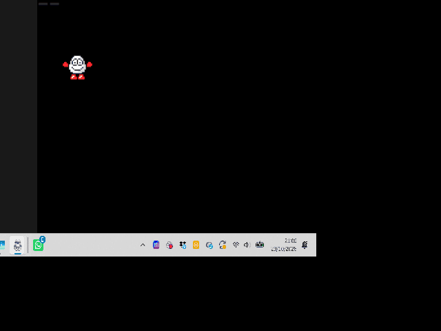

Welcome to the latest in my series of posts on Graphics with the SAM Coupé.

You can find the other posts in this series here;

1. [Sam Coupe Assembly Language Programming](https://www.pjgcreations.co.uk/sam-coupe-assembly-language-programming/)
2. [Graphics in Assembly for the SAM Coupé](https://www.petecodes.co.uk/graphics-in-assembler-for-the-sam-coupe/)
3. [Making SAM Coupé Sprites Transparent](https://www.petecodes.co.uk/graphics-with-the-sam-coupe-transparency/)
4. [Animating SAM Coupé Sprites](https://www.petecodes.co.uk/graphics-with-the-sam-coupe-animation/)
5. [Controlling SAM Coupé Sprites with the Keyboard](https://www.petecodes.co.uk/graphics-with-the-sam-coupe-keyboard-input/)

# Making Room for Graphics with Memory Paging

In the [previous post's draft](https://github.com/pjgpetecodes/samcoupegraphics/blob/main/assembly/blog6/blog-post.md), we loaded our own palette and added sideways jump animations. We also cropped the sprites so that the frames would fit beside our program.

Before we add scenery, we need somewhere to put it!

This time we are changing where the sprite data lives, not what Dizzy does. Z and X still animate walking, Space rolls, and holding Z or X while pressing Space plays a sideways jump. Dizzy stays in the same position; moving him across the screen comes next.

Thank you to Adrian Brown for supplying the sprites and helping with the series.

## What Is a Page?

The Z80 can address 64 KB at once. A standard SAM has 256 KB of RAM, so there is more memory than the processor can see at any one time.

The SAM splits its RAM into 16 KB pages. A 256 KB machine has pages 0 to 15; a 512 KB machine has pages 0 to 31.

The CPU address space is divided into four sections;

| Section | CPU addresses |
|---|---|
| A | `0x0000` to `0x3FFF` |
| B | `0x4000` to `0x7FFF` |
| C | `0x8000` to `0xBFFF` |
| D | `0xC000` to `0xFFFF` |

The Lower Memory Page Register, LMPR at port 250, selects the page in section A. The following page appears in section B. The High Memory Page Register, HMPR at port 251, does the same for C and D.

There are also ROM-mapping and protection flags, so a page number is not the whole register value. You can find the details in the [SAM technical manual's memory section](https://github.com/stefandrissen/sam-coupe-technical-manual/blob/main/techmanual.md#memory).

We have already used LMPR to bring a hidden screen into view for drawing. Now we will use the same window for sprite data too.

## Plan the Memory First

Our example uses the following physical pages;

| Pages | Contents |
|---|---|
| 1 and 2 | Resident program, animation tables, palette, frame buffer and stack |
| 3 | Unused padding in the loaded code file |
| 4 and 5 | The same 38 cropped frames used in the previous example |
| 10 and 11 | First screen |
| 14 and 15 | Second screen |

Each MODE 4 screen needs 24 KB, so it occupies one whole page and half the next. Our two screen starting pages still differ by four, allowing the existing `XOR 4` page flip.

All these pages exist on a 256 KB SAM. We leave HMPR alone, so the executing code and its stack never disappear when we change the lower mapping. SAMDOS calls our program with physical page 1 at `0x8000` and page 2 above it.

This is a standalone, reset-to-stop demonstration, not a routine which allocates RAM for a running BASIC program. It takes ownership of the listed pages and sets up its two screens explicitly.

## Step 1: Put the Sprites in Their Own Pages

We still begin the program with;

```z80
                ORG     0x8000
                DUMP    1,0
                AUTOEXEC
```

`ORG` describes the CPU addresses we are assembling for. `DUMP` tells pyz80 which physical RAM page receives the bytes in the disk image. They are related, but they are not the same thing.

The code, palette and animation tables stay in the resident area. At the end we change both the origin and the output destination for the sprite include;

```z80
                ORG     0
                DUMP    Sprite_Page,0
                INCLUDE "..\blog6\tidizzy_cropped.asm"
```

`Sprite_Page` is 4. We assemble the sprite labels from address zero because that is where we will see page 4 when we map it into section A. The include continues into physical page 5.

We have not changed the frame data or its mask/pixel pairs. The animation tables still hold two-byte frame addresses, but those addresses now refer to the lower window **when the sprite pages are mapped**, not to permanently visible RAM.

SAMDOS loads one code file spanning physical pages 1 through part of page 5. The gaps are padding in that file; `DUMP` is not a request for an extra runtime disk read. Booting this example therefore loads the banked sprites before our first instruction runs.

## Step 2: Save the Original Lower Mapping

We must be able to put the ROM and its working memory back before the next interrupt. At startup, with interrupts disabled, we save LMPR;

```z80
                IN      A,(LMPR)
                LD      (Saved_LMPR),A
```

Our mapping helper takes a physical page in A;

```z80
Map_Lower:      LD      C,A
                LD      A,(Saved_LMPR)
                AND     0b11000000
                OR      0b00100000
                OR      C
                OUT     (LMPR),A
                RET
```

The lower five bits select the page. Bit 5 maps RAM in place of ROM 0. The top two flags are preserved rather than being replaced with a magic value.

This helper is used with the normal SAMDOS entry state: ROM 1 is not covering the stack, and lower RAM is writable. It is not a general-purpose way to change arbitrary caller mappings.

Restoring is deliberately small;

```z80
Restore_Lower:  LD      A,(Saved_LMPR)
                OUT     (LMPR),A
                RET
```

All calls to `Map_Lower` happen with interrupts disabled. We do not enable interrupts until the lower mapping has been restored.

## Step 3: Copy One Frame Before Drawing

There is a catch. We cannot map sprite pages 4 and 5 and a hidden screen into the same lower window at the same time.

Instead, we keep one frame-sized buffer in resident memory;

```z80
Frame_Size:     EQU     Sprite_Bytes*Sprite_Rows*2
Frame_Buffer:   DEFS    Frame_Size
```

That is `13 * 22 * 2`, or 572 bytes. The factor of two is important: each screen byte has a mask byte and a pixel byte.

`Draw_Frame` finds the selected frame address from the animation table, just as before. Once that address is in HL, it maps the sprite pages and copies the frame;

```z80
                LD      A,Sprite_Page
                CALL    Map_Lower
                LD      DE,Frame_Buffer
                LD      BC,Frame_Size
                LDIR
```

`LDIR` can cross `0x3FFF` into `0x4000`: page 5 is already mapped after page 4. Frame 30 actually crosses this boundary, so the left-jump sequence is a useful check rather than only testing frames from the first page.

Now it is safe to replace the sprite mapping with the hidden screen;

```z80
                LD      A,(Display_Page)
                XOR     4
                CALL    Map_Lower
                CALL    Clear_Sprite
                LD      DE,Frame_Buffer
                LD      HL,Sprite_Start
                CALL    Draw_Sprite
                CALL    Restore_Lower
```

The existing masked drawing loop reads the resident buffer. It does not need to know that the original frame came from another page.

Finally we mark the frame ready and enable interrupts. The main loop waits with `HALT` and only flips to the completed hidden screen. We also keep reloading our palette after the ROM interrupt, as in the previous post.

## Check the Space We Have Saved

The assembled resident area ends at `0x8440`, including the frame buffer. The stack begins at `0xFF00`, well away from it.

The 38 cropped frames occupy 21,736 bytes in pages 4 and 5 instead of living above our resident code. We have gained room for later program state without throwing away animation frames.

There is now an extra 572-byte copy whenever a frame changes. That is a deliberate simplicity trade-off, not a promise that this is the fastest possible sprite system.

The source includes assembly-time checks for the resident limit and the expected sprite footprint. If we change the layout later, we should update the memory plan rather than just moving the stack and hoping!

## The Full Assembly

The complete source is [9-1.asm](https://github.com/pjgpetecodes/samcoupegraphics/blob/main/assembly/blog7/9-1.asm). It includes the existing cropped sprites and palette from Blog 6, so keep the repository's folder structure.

## Download the Disk Image

Download [the 9-1 disk](https://github.com/pjgpetecodes/samcoupegraphics/raw/refs/heads/main/disks/9-1.dsk) to run in SimCoupe or transfer to a SAM.

## The Result



The result should look familiar. The change is where we store the frames, not a new movement or physics system. The background starts black; keys 1 to 5 retain the previous palette demonstration.

## See the Result in the SAM Coupe Web Emulator

{{emulator:9-1}}

The embed uses the site's disk-hosting location. The new disk must be uploaded there before this embed can run; generating this draft does not publish or upload it.

## Building and Running

```powershell
python .\.vscode\sam_build.py .\assembly\blog7\9-1.asm --build-only
python .\.vscode\capture_gifs.py 9-1
```

The capture job runs this example on a 256 KB SAM. Hold Z or X to animate walking; press Space alone or with a direction for the roll/jump sequences. Releasing a direction during a jump does not interrupt the sequence. Holding Space can start another roll after the previous one finishes, as before. Reset to stop.

## Where to Go Next

Now the frames are out of our program's way, we can give Dizzy a position and move him across the screen. We will keep the background plain while we learn that part, then introduce scenery and the separate job of restoring it behind a moving sprite.
