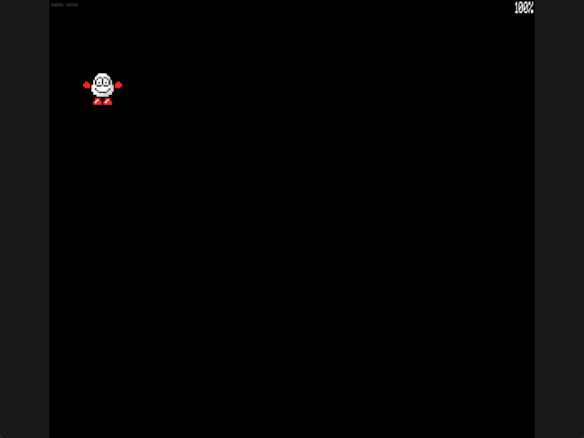

Welcome to the latest in my series of posts on Graphics with the SAM Coupé.

You can find the other posts in this series here;

1. [Sam Coupe Assembly Language Programming](https://www.pjgcreations.co.uk/sam-coupe-assembly-language-programming/)
2. [Graphics in Assembly for the SAM Coupé](https://www.petecodes.co.uk/graphics-in-assembler-for-the-sam-coupe/)
3. [Making SAM Coupé Sprites Transparent](https://www.petecodes.co.uk/graphics-with-the-sam-coupe-transparency/)
4. [Animating SAM Coupé Sprites](https://www.petecodes.co.uk/graphics-with-the-sam-coupe-animation/)
5. [Controlling SAM Coupé Sprites with the Keyboard](https://www.petecodes.co.uk/graphics-with-the-sam-coupe-keyboard-input/)

# Moving Dizzy Across the Screen

In the [memory paging post](https://github.com/pjgpetecodes/samcoupegraphics/blob/main/assembly/blog7/blog-post.md), we moved the sprite frames into their own RAM pages. Now it is time to move Dizzy himself!

We will do just that in this post. There is no scenery, gravity or collision detection yet. We keep the black background so we can concentrate on position and on removing the old image correctly.

Thank you to Adrian Brown for supplying the sprites and helping with the series.

## A Position Is Not an Animation Frame

Until now, holding Z selected the walking-left animation, but the drawing routine always used the same screen address. A sideways jump also changed the image without moving its position through the world.

We now need two independent pieces of information: which frame to draw, and where to draw it.

Our first position is measured in screen bytes;

```z80
Sprite_X:       DEFB    1               ; Current horizontal position in screen bytes
Previous_X_10:  DEFB    1               ; Position last drawn on physical screen 10
Previous_X_14:  DEFB    1               ; Position last drawn on physical screen 14
```

In MODE 4, one byte contains two pixels. Moving by one byte therefore moves Dizzy by two pixels. This deliberately avoids shifting masks and pixel nibbles until the next post.

The vertical position stays at row 5.

## Step 1: Move Independently of Animation

The animation still holds each frame for five interrupts. If we only moved when that frame changed, position updates would be tied to the animation's playback speed.

Instead, we call `Move_Sprite` in every main-loop iteration, after waiting for the frame interrupt;

```z80
                CALL    Show_Pending_Frame ; Display the completed hidden-page drawing
                CALL    Choose_Background ; Retain the previous palette demonstration
                CALL    Move_Sprite     ; Update position on every interrupt, not every frame
                CALL    Choose_Animation ; Choose which existing animation should play
                CALL    Update_Animation ; Advance its frame only when the delay expires
```

Movement updates at 50 Hz. The animation advances at its existing five-interrupt cadence.

The keyboard reads are the same active-low Z and X bits as before;

```z80
Move_Sprite:    LD      BC,0xFEFE       ; Select the Shift/Z/X/C/V keyboard row
                IN      A,(C)           ; Read the active-low direction bits
                BIT     1,A             ; Z is bit 1 and takes priority over X
                JR      Z,Move_Left     ; A zero bit means Z is held
                BIT     2,A             ; X is bit 2 of the same row
                RET     NZ              ; With neither key held, keep the current position
```

Z wins if both directions are held, matching our animation selection. We do not add another keyboard convention for movement.

## Step 2: Stay Inside the Screen

There are 128 bytes across a MODE 4 row. Our cropped sprite occupies 13 of them, so its furthest starting position is `128 - 13`, or 115.

That is a screen boundary check, not collision detection against the world. We have no walls or platforms yet.

For rightward movement we test the limit before incrementing;

```z80
                LD      A,(Sprite_X)   ; Read the horizontal position in screen bytes
                CP      Maximum_X       ; Check whether the sprite already meets the right edge
                RET     Z               ; Do not advance beyond the last complete rectangle
                INC     A               ; One screen byte moves two MODE 4 pixels
                JR      Store_X         ; Save the new position and redraw
```

For leftward movement we test zero before decrementing. Otherwise an unsigned byte would wrap from zero to 255;

```z80
Move_Left:      LD      A,(Sprite_X)   ; Read the position before moving left
                OR      A               ; Set Z if the leftmost byte is already zero
                RET     Z               ; Prevent unsigned underflow at the left edge
                DEC     A               ; Move left by one screen byte
Store_X:        LD      (Sprite_X),A   ; Store the new world-space horizontal position
                JP      Draw_Frame      ; Redraw even when the animation frame has not changed
```

Notice the final redraw. An unchanged animation frame can still need drawing at a new position.

We retain the existing rolls and sideways-jump animations. Position follows held Z/X independently, including while those sequences play. These are still not physical jumps: there is no vertical velocity or gravity yet, and releasing a direction stops translation even if the animation continues.

## Step 3: Turn the Position into a Screen Address

We begin with the fixed row's address and add our horizontal byte offset;

```z80
                LD      HL,Sprite_Row*128 ; Begin at the fixed screen row
                LD      A,(Sprite_X)   ; Read the current horizontal byte offset
                LD      E,A             ; Put that offset in DE
                LD      D,0             ; Clear its high byte
                ADD     HL,DE           ; Add X to get the screen destination address
                LD      DE,Frame_Buffer ; Read the staged frame from resident RAM
                CALL    Draw_Sprite     ; Draw the sprite at its new position
```

The drawing loop still advances 128 bytes between screen rows. Our 572-byte staging buffer and banked sprite frames work exactly as in the paging example.

## Step 4: Remember Where Each Page Was Drawn

Double buffering gives us two different old pictures. The screen hidden now may have last been drawn two updates ago, not one.

Clearing only the immediately previous position would leave a trail. Instead we keep `Previous_X_10` and `Previous_X_14`, one for each physical screen.

`Clear_Sprite` selects the saved position for the page it is actually drawing on;

```z80
Clear_Sprite:   LD      HL,Previous_X_10 ; Start with the old position for physical screen 10
                LD      A,(Display_Page) ; Infer which other page is currently hidden
                CP      Screen_Page     ; If 10 is displayed, we must erase screen 14
                JR      NZ,Old_Position ; Otherwise the first saved position is correct
                INC     HL              ; Select screen 14's saved horizontal position
Old_Position:   LD      B,(HL)          ; Keep the position last drawn on this hidden page
                LD      A,(Sprite_X)   ; Fetch the position we are about to draw
                LD      (HL),A          ; Remember it for this page's next erase
```

We preserve the old X in B, calculate that old rectangle's screen address, and clear it to colour zero. Only then do we draw at the current position.

This also handles two redraws before a page flip: after the first drawing, that page's saved position already points at the image the second drawing must erase.

Clearing to zero is correct for this plain background. It will not be correct once scenery is behind Dizzy; restoring scenery will get its own post.

## The Full Assembly

The complete, line-by-line commented example is [10-1.asm](https://github.com/pjgpetecodes/samcoupegraphics/blob/main/assembly/blog8/10-1.asm). Its palette and cropped sprites remain the existing Blog 6 includes.

## Download the Disk Image

Download [the 10-1 disk](https://github.com/pjgpetecodes/samcoupegraphics/raw/refs/heads/main/disks/10-1.dsk).

## The Result



Hold X to move right, then Z to move back. Dizzy stops at either screen boundary. The capture also releases a direction during a jump animation and tries both direction keys together.

## See the Result in the SAM Coupe Web Emulator

{{emulator:10-1}}

This embed needs the new disk uploaded to the site's disk-hosting location before publication. The repository download and the hosted web-emulator disk are separate destinations.

## Building and Running

```powershell
python .\.vscode\sam_build.py .\assembly\blog8\10-1.asm --build-only
python .\.vscode\capture_gifs.py 10-1
```

The memory layout still fits a 256 KB SAM. Keys 1-5 retain the palette demonstration, and Space retains the roll/jump animations. Reset to stop.

## Where to Go Next

We can move across the screen, but only two pixels at a time. Next we will handle odd and even pixel positions, including what happens when a mask has to cover part of an extra destination byte. We will not add scenery or collision in the same step.
