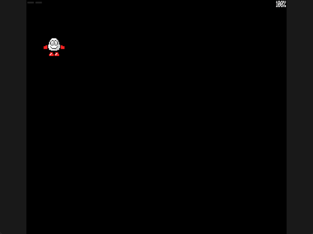

Welcome to the latest in my series of posts on Graphics with the SAM Coupé.

You can find the other posts in this series here;

1. [Sam Coupe Assembly Language Programming](https://www.pjgcreations.co.uk/sam-coupe-assembly-language-programming/)
2. [Graphics in Assembly for the SAM Coupé](https://www.petecodes.co.uk/graphics-in-assembler-for-the-sam-coupe/)
3. [Making SAM Coupé Sprites Transparent](https://www.petecodes.co.uk/graphics-with-the-sam-coupe-transparency/)
4. [Animating SAM Coupé Sprites](https://www.petecodes.co.uk/graphics-with-the-sam-coupe-animation/)
5. [Controlling SAM Coupé Sprites with the Keyboard](https://www.petecodes.co.uk/graphics-with-the-sam-coupe-keyboard-input/)

# Moving Dizzy at Pixel Resolution

In the [memory paging post](https://github.com/pjgpetecodes/samcoupegraphics/blob/main/assembly/blog7/blog-post.md), we moved the cropped sprite frames into their own RAM pages. In the [previous post](https://github.com/pjgpetecodes/samcoupegraphics/blob/main/assembly/blog8/blog-post.md), we moved Dizzy horizontally, one screen byte at a time.

Now we will position him at pixel resolution while keeping a similar movement speed. This post is still only about horizontal position and drawing the old and new rectangles correctly. There is no scenery, gravity, collision detection or new sprite set.

Thank you to Adrian Brown for supplying the sprites and helping with the series.

## Packed MODE 4 Pixels

Until now we have been able to treat the screen as a grid of bytes. Pixel positioning means looking inside those bytes, so it's worth looking at the layout properly first.

A MODE 4 screen is 256 pixels across and 192 rows down, with 16 colours available. Sixteen colours need four bits per pixel (2⁴ = 16), and a byte has eight bits, so the SAM **packs** two pixels into every screen byte;

```
 bit:   7   6   5   4   3   2   1   0
      +---------------+---------------+
      |  left pixel   |  right pixel  |
      |  (high nibble)|  (low nibble) |
      +---------------+---------------+
```

Four bits is called a **nibble**. The **high nibble** (bits 7-4) is the left-hand pixel on screen, and the **low nibble** (bits 3-0) is the pixel to its right. Written in hex, each digit is one pixel, in the same left-to-right order you see on screen, so `&F0` is “pixel `F`, then pixel `0`”.

A nibble is not a colour as such; it is a **palette index** from 0 to 15. As we saw in the palette post, the SAM looks that number up in its colour look-up table (CLUT), and changing one entry recolours every pixel holding that index at once.

Packing two pixels per byte gives the screen its shape in memory;

```
256 pixels / 2 pixels per byte = 128 bytes per row
192 rows * 128 bytes           = 24,576 bytes (24 KB)
byte offset for pixel (x, y)   = y * 128 + x / 2
pixel is in the high nibble if x is even, the low nibble if x is odd
```

That is why our drawing loops add 128 to move down a row, and why each screen fills one and a half 16 KB pages.

For example, here are three bytes decoded into the six pixels they hold;

| Byte | 0 | | 1 | | 2 | |
|---|---|---|---|---|---|---|
| Value | `&FF` | | `&F0` | | `&0A` | |
| Pixel X | 0 | 1 | 2 | 3 | 4 | 5 |
| Index | `F` | `F` | `F` | `0` | `0` | `A` |

Notice that the run of `0` pixels starts halfway through byte 1. That is the catch with packed pixels: **the smallest thing the Z80 can write is a byte, which is two pixels**. Writing one pixel without disturbing its neighbour means reading the screen byte, keeping the neighbour's nibble, replacing our own and writing the result back. Our interleaved masks already do exactly that, one nibble at a time. A sprite whose first pixel lands on an odd X, though, no longer lines up with the bytes it was drawn in, and that is the problem this post solves.

## Pixels and Bytes

The cropped Dizzy frame is 13 bytes wide, or 26 pixels. We now store X as a pixel coordinate instead of a byte offset;

```z80
Sprite_X:       DEFB    1               ; Current horizontal position measured in pixels
Previous_X_10:  DEFB    1               ; Pixel position last drawn on physical screen 10
Previous_X_14:  DEFB    1               ; Pixel position last drawn on physical screen 14
```

X is a pixel coordinate, and its low bit tells us whether the sprite starts on the first or second pixel in a screen byte. The movement alternates one- and three-pixel steps, so every update changes the alignment while keeping Blog 8's average movement speed.

For an **even** X, the first sprite pixel occupies the high nibble of the first destination byte. We can use the original 13-byte row unchanged. For an **odd** X, the first sprite pixel occupies the low nibble; every source pixel must shift into the next nibble position. That row then spans 14 destination bytes.

| Pixel X | First destination byte | Row width |
|---:|---:|---:|
| 0, 2, 4, … | `X / 2` | 13 bytes |
| 1, 3, 5, … | `floor(X / 2)` | 14 bytes |

## Step 1: Move at Pixel Resolution

Z and X are still read from the same active-low keyboard row. Z takes priority if both are held, and movement remains independent of the animation frame. Blog 8 requested two pixels on each update. A fixed one-pixel step would halve that requested pace, while a fixed three-pixel step would increase it by 50%. We alternate one- and three-pixel steps to keep the same two-pixel average, with every step changing between even and odd alignment. This is pixel-resolution positioning, not a claim that every movement step is exactly one pixel.

```z80
                LD      A,(Move_Phase)  ; Alternate one- and three-pixel steps
                OR      A               ; Set Z for a one-pixel step
                JR      NZ,Move_Right_Three ; Use the three-pixel step on the alternate update
                LD      A,(Sprite_X)    ; Read the current pixel position
                INC     A               ; Move one pixel and switch packed-nibble alignment
                JR      Store_X         ; Save the new position and redraw
Move_Right_Three: LD    A,(Sprite_X)    ; Read the current pixel position
                ADD     A,3             ; Move three pixels and switch packed-nibble alignment
                CP      Maximum_X+1     ; Check whether the sprite would pass the right boundary
                JR      C,Store_X       ; Keep the proposed position when it still fits
                LD      A,Maximum_X     ; Clamp the final step to the last complete position
                JR      Store_X         ; Save the bounded position and redraw
```

The new maximum is pixel 230. At X=230 the sprite starts at byte 115 and uses bytes 115–127, exactly the final 13 bytes in the screen row. At X=229 it starts at byte 114 and the odd-aligned image uses 14 bytes, also ending at byte 127. A further step would run off the right edge, so movement stops at 230.

At the left edge, the position is zero. As before, the bounds are screen limits only: they do not represent walls or collision.

## Step 2: Prepare the Odd-Aligned Frame

The original banked frames stay unchanged. When the animation selects a new 572-byte frame, we copy it into resident RAM and build a second form for odd positions. Each of its 22 rows has 14 mask/pixel pairs, so this staging buffer takes 616 bytes. The selected frame address is cached: movement redraws reuse both resident forms instead of rebuilding the shifted image on every pixel step.

Consider two adjacent source bytes, written as nibbles `A B` and `C D`. For the shifted row, the byte between them is `B C`. The routine rotates the previous byte left by four bits, rotates the next byte right by four bits, masks off the unused nibbles and joins the results.

The first output byte needs a transparent high nibble before the first sprite pixel. The final output byte needs a transparent low nibble after the last sprite pixel. In the mask buffer those padding nibbles are `F`; in the pixel buffer they are `0`. That preserves the destination outside Dizzy's 26 pixels.

The interleaving is retained throughout: each shifted mask byte is followed by its shifted pixel byte. The ordinary draw routine can therefore continue to combine them as `(screen AND mask) OR pixel`.

## Step 3: Draw and Erase the Correct Width

The pixel coordinate becomes a destination byte address by dividing it by two. Its low bit separately chooses the original or shifted frame and the matching 13- or 14-byte width.

Double buffering still has a separate previous X for each physical screen. We also use the **old** X's low bit when clearing that screen: if the previous drawing was odd, clear 14 bytes; if it was even, clear only 13. The next row address uses the corresponding width too. This matters when an even position moves to an odd one (or back again); using the new width to erase the old rectangle could leave a pixel trail or clear a neighboring byte.

The loop waits for the 50 Hz interrupt, but that is not a guarantee of 50 completed movement updates per second: drawing takes time and interrupts are disabled during banked work. Two pixels per update would nominally give 100 pixels per second. Wall-clock measurements from the normal-speed SimCoupe recordings instead showed approximately 80 pixels per second in both Blogs 8 and 9; missed interrupts were not counted individually. The animation delay remains five loop updates, nominally ten frames per second, and the stationary roll showed pose changes roughly every 0.1 seconds. These are measured observations, not a cycle-budget guarantee.

The frame delay and animation tables are unchanged. Caching avoids repeating the odd-frame conversion during movement redraws; it does not deliberately shorten the animation delay. This example runs at SimCoupe's normal speed, not turbo. Space, directional jumps and palette keys 1–5 keep their previous behavior. The roll and sideways-jump sequences are animations, not physical jumps: there is still no velocity or gravity, and releasing Z or X stops horizontal movement.

## The Full Assembly

The complete example, with every source line commented, is [11-1.asm](https://github.com/pjgpetecodes/samcoupegraphics/blob/main/assembly/blog9/11-1.asm). It reuses the unchanged palette loader and the same 38 cropped frames from Blog 6.

## Download the Disk Image

Download [the 11-1 disk](https://github.com/pjgpetecodes/samcoupegraphics/raw/refs/heads/main/disks/11-1.dsk).

## The Result



Hold X to move right and Z to move back. The demonstration passes through both even and odd pixel positions, stops at both edges, releases each direction, and retains the original jump controls.

## See the Result in the SAM Coupe Web Emulator

{{emulator:11-1}}

This embed needs the new disk uploaded to the site's disk-hosting location before publication. The repository download and the hosted web-emulator disk are separate destinations.

## Building and Running

```powershell
python .\.vscode\sam_build.py .\assembly\blog9\11-1.asm --build-only
python .\.vscode\capture_gifs.py 11-1
```

The 256 KB memory layout is unchanged: the executing program, stack, raw frame buffer and shifted frame buffer remain resident in pages 1–2; the 38 source frames are in pages 4–5; and the two display pairs begin at pages 10 and 14. Reset to stop.

## Where to Go Next

We can now position Dizzy at every horizontal pixel, but the background is still black and every old rectangle is erased to colour zero. The next post introduces static scenery without a moving player. Restoring that scenery behind a moving sprite follows in its own post.
